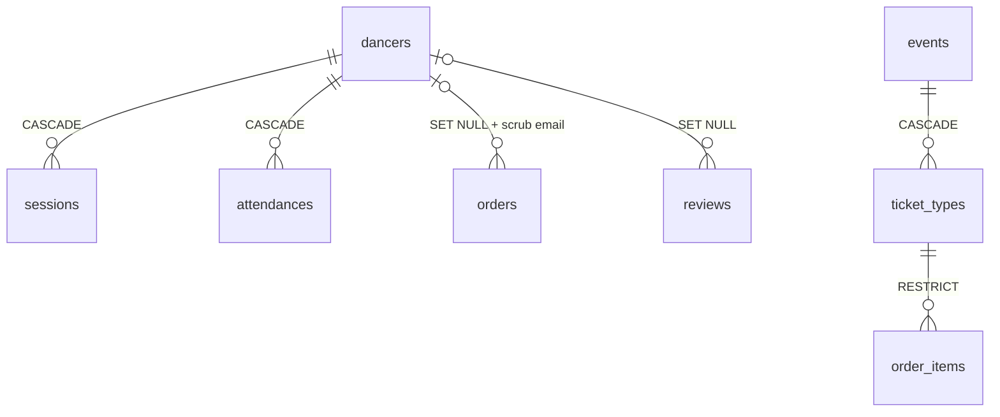

## Context

Most integrity rules live only in router code, and several are already broken.

- **Links by text instead of foreign keys.** `festival_waves.festival_slug`
  (`schema.ts:721`), `reviews.target_type`/`target_slug` (`241-242`),
  `events.venue_username`/`organizer_username` (`617-618`), `events.artists` and
  `booking_requests.artists` as JSON handle lists (`638`, `376`),
  `plan_items.item_id` (`569`), `moderator_elections.winner_candidate_id` and
  `election_vote_history.from/to_candidate_id` without FKs (`449`, `489-490`),
  every `city_slug` column, and `events.series_id` as text (`636`).
- **No delete rule anywhere.** All 51 foreign keys in the latest snapshot
  (`migrations/meta/0018_snapshot.json`) are `no action`. The consequence is real:
  `auth.deleteAccount` (`routers/auth.ts:458-626`) touches 27 tables by hand in "FK
  order" but misses `artist_follows` and `festival_waves`, both added later with FKs
  to `dancers` (`schema.ts:707`, `722-723`). For any dancer who followed an artist
  or waved at someone, the whole batch fails with an FK violation — GDPR erasure
  (RAZ-155) silently stopped working.
- **Enums are TypeScript-only.** Every status/kind column is `text` with `.$type<>()`
  (e.g. `schema.ts:93`, `159`, `241`, `385`, `568`); the database accepts any string.
  They already disagree: `review.ts:6` accepts `'event'` as a target type, the
  schema union at `schema.ts:241` does not.
- **`json` and `jsonb` are mixed** (`dancers.dance_styles` is `json` at `schema.ts:9`,
  `dance_levels` is `jsonb` at `12`; `profiles.styles/languages/socials`,
  `booking_requests.styles/artists`, `festival_submissions.payload`, `gigs.styles`
  are `json`). `json` has no equality operator, no GIN index and no containment.
- **Time is stored three ways.** Every timestamp is `timestamp` without time zone;
  `events` stores UTC in it by convention (`schema.ts:599-601`); slot and booking
  times are `'HH:MM'` text (`378-379`, `403-404`, `550`); `gigs.when` is free text
  (`527`). Server code formats event times with the server clock
  (`plan.ts:713-714` uses `getHours()`), ignoring `events.timezone`.
- **Nullable where it must not be.** `created_at` is nullable on 34 of 38 tables
  and missing on `festivals`, `dinners` and `dinner_group_members` (only `cities`
  has it `NOT NULL`);
  `dancers.is_admin` is nullable (`schema.ts:16`, hence `?? false` in
  `context.ts:50`); `events.slug`/`name` are nullable (`606-607`);
  `festival_signups` is unique on `(festival_id, dancer_id)` with a nullable
  `dancer_id` (`79`, `96`), so stubs are never deduplicated.
- **Counters drift.** `hangouts.people_count` is set to 1 on create
  (`hangouts.ts:97`) and never updated by `toggleRsvp`; `city_videos.vote_count` and
  `elo_score` are read-modify-write without a lock (`cityVideo.ts:262-281`), so
  concurrent votes lose updates; `community_groups.report_count` duplicates
  `count(community_group_reports)`.
- **Capacity checks race.** `festivalSignup.join` (`festivalSignup.ts:84-101`) and
  `dinner.join` (`dinner.ts:107-118`) count, then insert: two requests can both see
  the last free spot.
- **No transactions are possible today.** The app uses `drizzle-orm/neon-http`
  (`server/utils/db.ts:2`), whose `transaction()` throws "No transactions support
  in neon-http driver" (`node_modules/drizzle-orm/neon-http/session.js:151-152`).
  `booking.setAvailability` calls `ctx.db.transaction` (`booking.ts:292`), so it can
  never succeed; multi-statement writes such as `election.close`
  (`election.ts:335-364`) and dinner group assignment run statement by statement.
- **Foreign-key columns without indexes**: `sessions.dancer_id` (looked up on every
  delete), `booking_requests.space_id`/`profile_id`/`organizer_id`/`requester_id`,
  `dinner_signups.dancer_id`, `giveaway_entries.dancer_id`,
  `festival_signups.dancer_id`, `referrals.referee_id`, `hangout_rsvps.dancer_id`.

## Options

1. **Keep integrity in application code** and add tests. Every new table repeats
   the `deleteAccount` mistake; scripts and the v3 sync bypass routers anyway.
2. **Postgres native `enum` types** for every status. Strong, but adding a value
   needs `ALTER TYPE … ADD VALUE` (cannot run inside a transaction block on older
   Postgres, cannot remove values) and drizzle-kit diffs them poorly.
3. **Constraints in the database, conventions in one place**: real FKs with an
   explicit delete rule, `CHECK` constraints for closed value sets, `jsonb` only,
   `timestamptz`, `NOT NULL` defaults, derived counters, transactions for
   multi-statement writes.

## Decision

Option 3, applied through the expand/contract process of ADR-001. The rules:

- **Every reference is a foreign key** to a primary key. Text handles, slugs and
  JSON id lists become FK columns or join tables (the ADRs per context say which).
  Where a relation is "one of several parents" we use an *exclusive arc*: one
  nullable FK column per parent plus `CHECK (num_nonnulls(a_id, b_id) = 1)` —
  never `(type, id)` text pairs.
- **Every FK declares `ON DELETE`**, by ownership:
  - `CASCADE` for rows that only exist for their parent (sessions, sign-ups,
    picks, RSVPs, follows, waves, votes in an open election, a dancer's goals);
  - `SET NULL` for rows that must survive as history or money records (orders,
    reviews, gigs, booking requests, video votes, guideline versions) — with the
    PII on the row scrubbed by the same deletion;
  - `RESTRICT` where deleting the parent is a business decision (an event with
    paid orders, a ticket type that was sold).
  `auth.deleteAccount` then shrinks to "delete the dancer and scrub PII on
  `SET NULL` rows", and a test asserts that every FK to `dancers` has a rule.
- **Closed value sets use `CHECK (col IN (…))` on `text`**, generated from one
  TypeScript `as const` array per enum (`shared/enums.ts`) that both zod and
  Drizzle import. We deviate from native enums on purpose: adding a value is a
  plain `ALTER TABLE … DROP/ADD CONSTRAINT`, and removing one is possible.
- **`jsonb` only, and only for documents** (payloads, provenance, metadata blobs).
  Lists of scalars (styles, languages, roles) are `text[]` with a GIN index; lists
  of references are join tables. No new `json` columns; existing ones convert with
  `ALTER COLUMN … TYPE jsonb USING col::jsonb` (or `text[]`) after a backfill check.
- **Instants are `timestamptz`.** Wall-clock data keeps its zone: events carry an
  IANA `timezone`, recurring slots use `time` plus the venue's zone, dates without
  time use `date`. Existing `timestamp` columns convert with
  `USING col AT TIME ZONE 'UTC'` (they hold UTC today). Free-text times
  (`gigs.when`) become structured columns plus an optional display note.
- **`NOT NULL` with defaults** for `created_at`/`updated_at`, booleans and anything
  the code already treats as required. `updated_at` is maintained by one trigger
  function, not by each router.
- **Counters are derived** with `count(*)` and an index, unless a read path proves
  too slow; then they are maintained by a trigger in the same transaction, never by
  application read-modify-write. ELO updates use a single
  `UPDATE … SET elo = elo + $delta` per row inside a transaction with
  `SELECT … FOR UPDATE` on both videos.
- **Capacity is enforced atomically**: the insert is conditional
  (`INSERT … SELECT … WHERE (SELECT count(*) …) < capacity` inside a transaction
  holding a `FOR UPDATE` lock on the parent row).
- **Every FK column is indexed** (leading column of some index).
- **Two database clients.** `useDb()` stays on `neon-http` for single-statement
  reads and writes (lowest latency on Vercel). A new `withTx(fn)` uses the Neon
  serverless `Pool` (`drizzle-orm/neon-serverless`, WebSocket) for interactive
  transactions; every multi-statement mutation must use it. `db.batch()` remains
  for fixed statement lists.

## Consequences

- Account deletion, the v3 sync and admin scripts all get the same guarantees as
  the routers.
- Adding a status value is a migration, not just a TypeScript edit. That is the
  point.
- The conversion of large tables (`events` 11,192 rows, `profiles` 6,589,
  `dancers` 3,932 — `docs/research/2026-10-12-city-canonicalisation.md:22-25`) is
  quick at this size, but each `ALTER … TYPE` rewrites the table and takes an
  `ACCESS EXCLUSIVE` lock; they run in a low-traffic window, one table per
  migration.
- A second driver (`neon-serverless` Pool) is added; it needs WebSocket support in
  the Vercel Node runtime (available) and must be closed per request.

## Stories unblocked

RAZ-155 (account erasure works again), RAZ-118 (correct "N in" counts),
RAZ-158 (venue availability can be saved), map:meetup-2.2-free-spot-counter
(free spots cannot be oversold), map:meetup-5.1-dinner-sign-up (dinners cannot
be overfilled).
