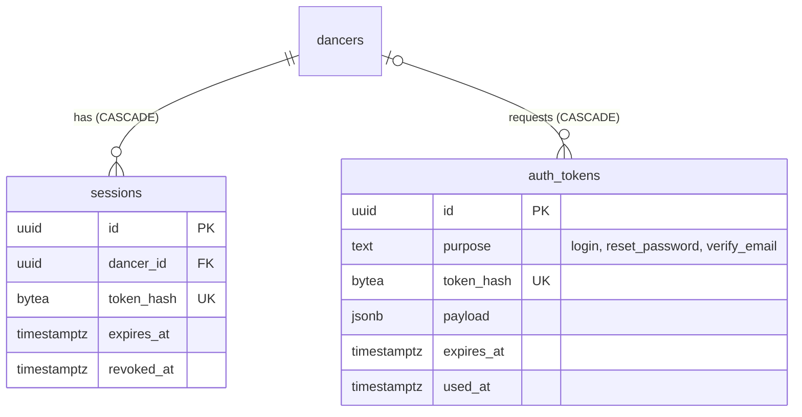

## Context

The auth layer was ported from wedance-v4 for continuity (FirebaseScrypt hashes
verify unchanged — `docs/data-migration-plan.md` §0). The port kept v4's weak
spots and added a few. The seven areas below are tracked in the current-state
review (findings #1, #2, #6, #8, #9, #23, #26); exploit-level detail is withheld
until each fix ships.

- **Secrets stored in plaintext.** Session and magic-link tokens are stored
  unhashed; a database leak yields live credentials.
- **Magic-link requests can modify existing accounts** before ownership is proven.
- **Email is trusted but never verified.** Registration and ticket-claiming treat
  email as proof of identity with no confirmation step.
- **Login and reset share one token** with no purpose field.
- **Salts use insufficient entropy** (not a CSPRNG).
- **Sessions are client-owned.** Cookie flags, server-side revocation, and
  credential-change invalidation are missing.
- **Public write endpoints lack validation and rate limiting.** Upload, login,
  feedback, and booking mutations accept unbounded input from unauthenticated
  callers.
- **PII in public responses.** Several API endpoints return data beyond what the
  caller should see, including contact details and privacy-gated fields.

## Options

1. **Patch each hole in place** (salt fix, a size check, a `where` clause). Needed
   anyway, but leaves the model (plaintext secrets, client-owned sessions,
   unverified email) intact.
2. **Adopt a hosted auth provider** (the dormant `dancers.neon_auth_id`,
   `schema.ts:15`, points at Neon Auth). Solves sessions and verification, but
   breaks password continuity for 2,339 migrated v4 hashes unless every user
   resets, and it is a product decision (social login, map:meetup-2.4).
3. **Harden the existing auth model**: hashed single-purpose tokens, verified
   email as a gate, server-owned `HttpOnly` sessions with revocation, CSPRNG
   salts, guarded public writes, explicit output shapes.

## Decision

Option 3 now; option 2 stays possible later because the session and token tables
below are provider-agnostic.

- **`auth_tokens`** replaces `dancers.magic_token*`: `id`, `dancer_id` (nullable for
  sign-up), `email`, `purpose` (`login` · `reset_password` · `verify_email`),
  `token_hash bytea` (SHA-256 of 32 random bytes; the raw token only ever appears
  in the email link), `payload jsonb` (sign-up fields for a not-yet-existing
  account), `expires_at`, `used_at`. Consuming a token is a single
  `UPDATE … SET used_at = now() WHERE token_hash = $1 AND used_at IS NULL AND expires_at > now() RETURNING …`.
  Requesting a link **never** writes to `dancers`; profile fields from the request
  are applied only when the token is consumed.
- **`dancers.email_verified_at timestamptz`.** Set when a `login` or `verify_email`
  token is consumed; backfilled for v4 users whose v4 record was verified and for
  dancers who already signed in via magic link. Password registration sends a
  `verify_email` token. **Verified email is required** for webhook auto-linking
  (otherwise the row stays an unclaimed stub) and for claiming ticket rows.
- **`sessions.token_hash bytea`** replaces `sessions.token`; add `last_seen_at`,
  `revoked_at`, `user_agent`. The server sets the session cookie (`HttpOnly`,
  `Secure`, `SameSite=Lax`) from the auth mutations; `auth.signOut` revokes the
  row; password reset/change revokes all other sessions. The `Authorization:
  Bearer` header stays accepted for one release while clients move to the cookie.
  Existing plaintext sessions are hashed in place (expand: add `token_hash`,
  backfill `sha256(token)`, read by hash, then drop `token`), so nobody is signed
  out.
- **Salts from `crypto.randomBytes(16)`**. FirebaseScrypt parameters stay identical
  so v4 hashes keep verifying.
- **Upload** becomes protected, capped at 5 MB, accepts only `image/jpeg`,
  `image/png`, `image/webp` (sniffed, not trusted from the header) and uploads into
  a per-dancer folder.
- **Rate limits** via one tRPC middleware backed by a Postgres table
  `rate_limits(key text, window_start timestamptz, hits int, PRIMARY KEY (key, window_start))`
  and a single `INSERT … ON CONFLICT DO UPDATE SET hits = hits + 1 RETURNING hits`.
  No new infrastructure. Keys combine procedure, client IP and, for auth, the
  email.
- **Public outputs are explicit and privacy-filtered.** No `select()` of whole rows
  in public procedures (ADR-011). One shared predicate decides whether a dancer may
  appear in any public list (`profile_public` and the per-event visibility of
  ADR-008); `getClaimStatus` is removed (the claim page asks the signed-in user).
- **Previews never see production** (ADR-001).

## Consequences

- A leaked database no longer yields usable sessions or links.
- Dancers who registered with a password but never verified their email must
  verify before their purchased tickets attach to the account; the UI explains it.
- One more round trip on magic-link sign-up (account created on consume, not on
  request).
- Some public pages lose data they showed before (gig contact email moves behind
  "Apply", booking messages stay with the venue).

## Stories unblocked

RAZ-275 and RAZ-288 (safe photo upload), RAZ-241 (reset with a purpose-bound
token), map:meetup-2.1-sign-up, RAZ-83 (verified ticket claims), RAZ-155
(sign-out and erasure revoke sessions).
