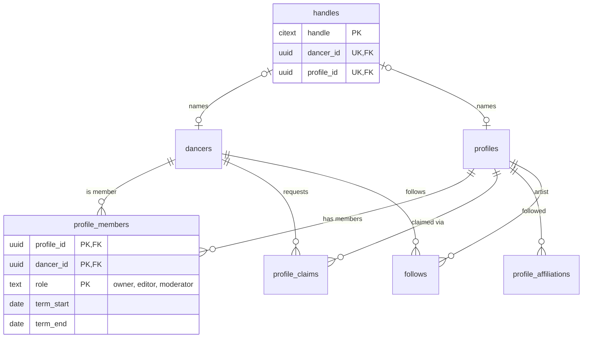

## Context

WeDance has two kinds of identity: **dancers** (accounts that sign in,
`schema.ts:4-44`) and **profiles** (venues, artists, organisers — 6,589 rows,
mostly migrated from v4 and synced from v3, `schema.ts:304-340`). Nothing connects
them.

- **Profiles have no owner.** The only ownership signal is `profiles.claimed`
  (`schema.ts:334`), a boolean with no "by whom". Consequences:
  - A commercial venue cannot see or answer the booking requests sent to it.
    `booking.request` stores them (`booking.ts:222-243`) and nothing notifies
    anyone (RAZ-129, RAZ-135, RAZ-142, RAZ-158).
  - An organiser cannot manage their own listing or events (RAZ-126, RAZ-33).
- **Festival ownership is inferred.** Insights access is granted to whoever
  submitted an onboarded `festival_submissions` row with the same slug
  (`festivalInsights.ts:30-39`, `54-66`). There is no owner column.
- **Moderator authority is a text match.** Space stewardship is checked by
  comparing `profiles.moderator_handle` with the caller's `dancers.username`
  (`election.ts:46-60`, `booking.ts:16-35`). The flat
  `moderator_name/handle/since` columns (`schema.ts:330-332`) are written by
  `election.close` (`election.ts:346-354`) next to the proper election tables,
  so the same fact lives twice.
- **Two handle namespaces share one URL.** `dancers.username` and
  `profiles.username` are each unique (`schema.ts:21`, `306`) but nothing stops a
  dancer and a venue from holding the same handle; `/@handle` resolves profiles
  first, then dancers (`entity.ts:6-11`), so one silently shadows the other.
  `dancers.username` is nullable and only backfilled at onboarding
  (`auth.ts:377-386`).
- **Two artist models.** `/artists/[id]` and festival lineups read the static
  `app/data/artists.ts` (`app/pages/artists/[id].vue:8`,
  `app/pages/festivals/[slug].vue:5`); `/@handle`, `/artists` and follows use
  `profiles` with `type = 'artist'`. Following an artist does not connect to the
  festivals they teach at (RAZ-55 notes).
- **No artist sub-type, no school.** `profiles.type` is only
  venue · artist · organizer (`schema.ts:307`); teachers, DJs and performers are
  indistinguishable and "find your teacher's school" has no data (RAZ-303, RAZ-66).
- **Two follow graphs.** `artist_follows` (dancer → profile id, `schema.ts:705`)
  and the legacy `follows` table from the v4 import (dancer → target *username*,
  667 edges, `scripts/migrate/00-schema.mjs:32-39`), which is not in `schema.ts`.
- **Gig posters are free text** (`gigs.poster_name`/`poster_type`,
  `schema.ts:523-524`), not linked to a profile (RAZ-145).

## Options

1. **`profiles.owner_dancer_id`** — one owner per profile. Simple, but venues and
   schools are run by teams, and moderators are a second, term-bound role on the
   same profile.
2. **Merge dancers into profiles** (v4-style: a dancer is a profile of type
   `dancer`, the account is separate). One namespace for free, but dancers and
   professional profiles differ in privacy defaults, lifecycle (erasure vs.
   unclaimed public listings) and fields; every dancer query would need a type
   filter, and 3,932 accounts plus every FK to `dancers` would move.
3. **Membership table + a handle registry**: keep `dancers` as accounts, keep
   `profiles` as professional pages, connect them with `profile_members`
   (role-based), and make handles one table that both point into.

## Decision

Option 3.

- **`profile_members(profile_id, dancer_id, role, granted_at, granted_by, term_start, term_end)`**,
  primary key `(profile_id, dancer_id, role)`. Roles: `owner` · `editor` ·
  `moderator`. A moderator membership is term-bound and is created by
  `election.close`; the flat `profiles.moderator_*` columns are dropped once reads
  use memberships. Every "may this dancer manage this profile/space/festival?"
  check becomes one indexed lookup, `requireProfileRole(profileId, roles[])`,
  replacing the handle comparisons.
- **`profile_claims(id, profile_id, dancer_id, status, method, evidence, decided_by, decided_at, created_at)`**.
  Claiming an unclaimed profile is a request (`pending` → `approved`/`rejected`);
  approval creates the `owner` membership and sets `profiles.claimed_at`
  (replacing the boolean). The first version is admin-reviewed with free-text
  evidence; automated methods (code in Instagram bio, email on the venue's domain)
  can be added as `method` values later.
- **`handles(handle citext PRIMARY KEY, dancer_id uuid UNIQUE, profile_id uuid UNIQUE, created_at)`**
  with `CHECK (num_nonnulls(dancer_id, profile_id) = 1)` and a reserved-word check.
  The backfill inserts every `profiles.username` first, then every
  `dancers.username`; collisions are reported before anything is written and the
  dancer side gets a suffixed handle (profile handles are the indexed SEO URLs).
  `dancers.username` and `profiles.username` stay as read-only mirrors until reads
  move to `handles`, then are dropped. Every dancer gets a handle at sign-up, not
  at onboarding.
- **Artist roles and affiliations.** `profiles.roles text[]` with a check against
  one vocabulary (`teacher`, `dj`, `performer`, `mc`, `band`, `photographer`,
  `videographer` for artists; `school`, `promoter`, `festival`, `community` for
  organisers) and a GIN index for filters. `profile_affiliations(artist_profile_id, organizer_profile_id, kind)`
  links a teacher to the school they teach at (`teaches_at` · `resident` ·
  `member`).
- **One artist model.** `app/data/artists.ts` is retired: its artists become (or
  match) `profiles` rows and festival lineups reference them through
  `event_artists` (ADR-006). `/artists/[id]` redirects to `/@handle`.
- **One follow graph.** `artist_follows` is renamed `follows(dancer_id, profile_id)`;
  the legacy `follows` edges are resolved from `target_username` to a profile id
  and merged. Edges whose username is a *dancer* stay in `legacy_follows` until
  the product decides whether dancers can follow dancers (see open questions).
- **Gig posters** gain `poster_profile_id` (nullable FK), keeping the free-text name
  for posters without a profile.

## Consequences

- Venues, schools and festival organisers can finally act inside the product;
  booking notifications have a recipient.
- A handle is unique across dancers and profiles; some dancers whose handle
  collides with a profile get a new one (one-time notice).
- Admins carry a new review queue (claims) until automated claim methods exist.
- `follows` and `legacy_follows` replace two half-graphs; dancer-to-dancer
  following is explicitly deferred, not accidentally half-built.

## Stories unblocked

RAZ-129, RAZ-135, RAZ-142, RAZ-158, RAZ-159 (venues receive and answer
bookings), RAZ-303 and RAZ-66 (artist roles, schools), RAZ-55 and RAZ-161
(lineups and follows on the same artist), RAZ-145 (gig poster identity),
RAZ-79 and RAZ-150 (organiser access by membership), RAZ-152 and RAZ-166
(moderators by membership), RAZ-253.
