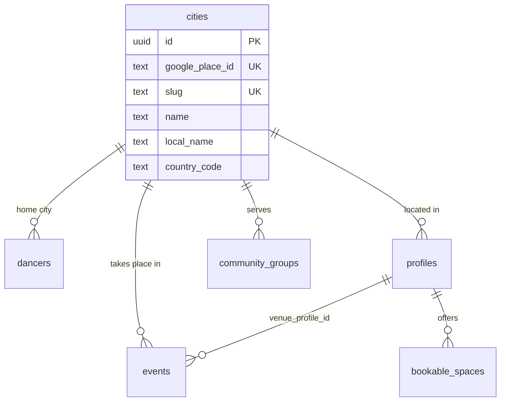

## Context

- **City is free text or a slug everywhere.** Free-text name columns:
  `dancers.city`, `profiles.city`, `events.city`, `festivals.city`,
  `gigs.location`, `festival_ride_shares.origin_city`. Slug columns with no
  reference: `profiles.city_slug`, `events.city_slug`, `city_videos`,
  `video_votes`, `giveaways`, `reviews`, `community_groups`,
  `recommendation_requests`, `hangouts`, `city_battle_votes` (both sides).
  Production has 585 distinct spellings across them, with four spellings of
  Munich in seven `gigs` rows (`docs/research/2026-10-12-city-canonicalisation.md:20-60`).
- **The `cities` table is referenced by nothing** (`schema.ts:739-759`) and is not
  in production yet (`city-canonicalisation.md:18`).
- **Matching is by string.** `plan.discover` derives a slug from free text
  (`plan.ts:483-484`) and matches dancers with `ilike` (`plan.ts:533`);
  `/artists?city=` compares `profiles.city` strings (RAZ-64 notes); "Real numbers"
  counts profiles per `city_slug` (RAZ-47).
- **Audience geography cannot be computed** (RAZ-85): `dancers.city` is free text.
- **Venue address is a single text field** (`profiles.address`, `schema.ts:316`)
  while events carry their own `venue_name`, `venue_address`, `venue_lat`,
  `venue_lng` (`schema.ts:630-633`). Venue filters for event planners need
  amenities that do not exist (RAZ-302).
- A detailed, already-reviewed plan exists for the city part:
  `docs/research/2026-10-12-city-canonicalisation.md` §Plan (7 steps).

## Options

1. **Keep slugs as the key** and canonicalise slug spelling. Cheap, but a slug is
   derived from a name, so renames and alternative spellings keep breaking
   identity, and nothing enforces that a slug exists.
2. **`city_id` foreign keys to the Google-Places-backed `cities` table**, slugs only
   as URL keys joined from `cities.slug`.
3. **A general `places` table** (cities, venues, addresses as one hierarchy).
   Flexible, but venues are already `profiles` with pages, members and bookings;
   a second venue entity would split them again.

## Decision

Option 2 for cities, exactly as the canonicalisation plan lays out (apply `0024`,
backfill `cities`, add nullable `city_id` columns, fill, dual-write, switch reads,
drop the text columns last with separate approval). This ADR adds the venue part:

- **Venue = `profiles` row with `type = 'venue'`** (no new entity). Its address
  becomes structured: `address_line`, `postal_code`, `city_id`, `country_code`,
  `lat`, `lng`, `google_place_id` (unique where not null; it is already the v4
  venue-handle convention used by the v3 sync dedupe, `CLAUDE.md` "Profiles (since
  0022)"). `address` (free text) stays as the display line until reads move.
- **Events reference the venue by FK** (`events.venue_profile_id`, ADR-006). The
  `venue_name/address/lat/lng` columns on `events` remain as a *snapshot* for
  events whose venue has no profile (v3 rows the sync could not match).
- **Amenities and floors are vocabularies.** `profiles.amenities text[]` (bar,
  stage, sound system, changing room, parking, step-free access, …) and
  `floor_type` constrained to `wood` · `parquet` · `vinyl` · `tiles` · `concrete`
  · `other`, on both venues and `bookable_spaces`. GIN index on `amenities` for
  the /venues filters.
- **Every city-scoped table gets `city_id`** (including `hangouts`, `community_groups`,
  `giveaways`, `city_videos`, `video_votes`, `recommendation_requests`, `reviews`,
  `city_battle_votes.winner_city_id/loser_city_id`, `gigs.city_id` with an explicit
  `is_remote` flag instead of free-text "Remote").

## Consequences

- "Munich", "München" and "Мюнхен" become one city in every count, filter and
  feed; audience geography is a `GROUP BY city_id`.
- City URLs stay stable (`cities.slug` keeps the existing slug rule).
- The v3 sync resolves venue localities through the city service instead of a
  string map (canonicalisation plan step 5).
- Dropping the free-text columns is the only irreversible step and waits for its
  own approval.

## Stories unblocked

RAZ-85 (audience geography), RAZ-64 and RAZ-50 (artists by city), RAZ-47 and
RAZ-139 (real per-city numbers), RAZ-127 (discover by city), RAZ-302 (venue
filters), RAZ-45 and RAZ-169 (city directories on ids, not strings).
