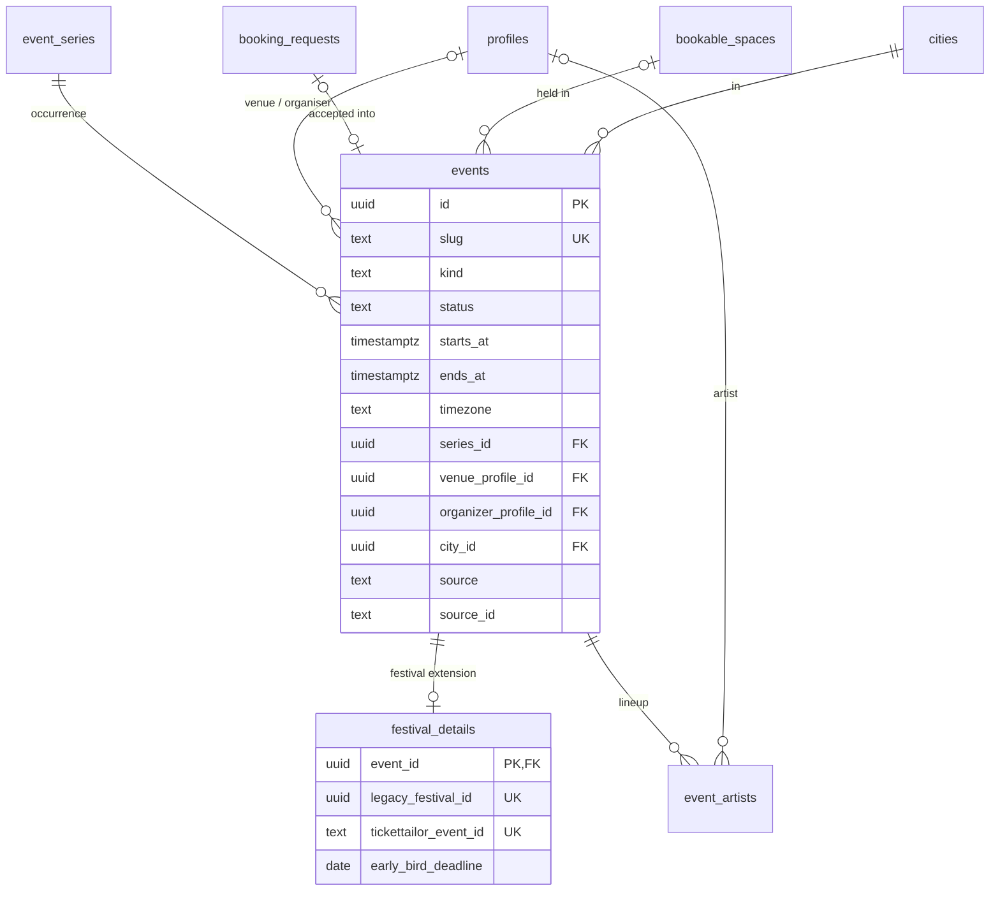

## Context

"An event" lives in three places today, plus a flag:

- **`events`** (`schema.ts:604-648`) — created out of band on 2026-07-15
  (`scripts/migrate/00-schema.mjs:8-28`). It holds 9,580 archived v4 events and
  the live v3 mirror (~1,300–1,600 upcoming; 11,192 rows in total,
  `docs/research/2026-10-12-city-canonicalisation.md:24`). State is two booleans,
  `archived` (default **true**, `620`) and `published` (`621`); festival-type rows
  carry `is_festival` (`613`).
- **`booking_requests`** act as events: "a booking IS a scheduled event"
  (`schema.ts:369-370`). The city feed merges them with `events` at read time
  (`app/pages/cities/[city]/index.vue:83`, RAZ-162), `/events/[id]` tries a booking
  first and an `events` row second (`app/pages/events/[id].vue:41-45`), and
  **pending, unapproved requests appear publicly** — the public feeds only filter
  out `declined` (`booking.ts:79`, `111`) while `booking.request` is a public
  mutation (`booking.ts:149`).
- **`festivals`** (`schema.ts:54-72`, 6 rows). The detail page prefers hardcoded
  mocks (`app/pages/festivals/[slug].vue:27-34`) and falls back to the database. A
  festival can exist both as a `festivals` row and as an `events` row with
  `is_festival` (RAZ-105 notes). Festival children reference `festivals.id`
  (dinners, sign-ups, rides, roommates, referrals) or the slug as text
  (`festival_waves.festival_slug`, `schema.ts:721`).
- **Recurrence** is a text `events.series_id` (`schema.ts:636`) with no series
  record. Courses are copied into `plan_items.metadata` at enrolment
  (`app/pages/my-plan.vue:1047-1048`), so a weekly class is one frozen occurrence.
- **People are linked by text**: `venue_username`, `organizer_username`
  (`617-618`) and `artists` as a JSON list of handles or names (`638`), matched by
  string with a name fallback (`events.ts:80-87`).
- **Provenance is half-modelled**: v3 rows have `source`/`source_id`
  (`625-626`), v4 rows only `source_ref` (`622`).
- **Nobody can create an event in the product.** `events` rows come only from the
  v3 sync, bookings only via a venue booking (RAZ-126 notes).
- The Commander locked the festival rule on 2026-07-13: *an event is a festival
  when it is multi-day or has tickets/workshops* (`docs/data-migration-plan.md`
  §8, decision 3).

## Options

1. **Keep three stores and unify at read time** (a SQL view over `events`,
   accepted bookings and festivals). No migration, but every FK that should point
   at "an event" (attendance, plans, reviews, tickets) still has to pick a table.
2. **One wide `events` table** with every festival column nullable (single-table
   inheritance). One identity, but festival-only columns (free spots, early bird,
   branding, provider mapping) bloat 11k rows that never use them, and their
   `NOT NULL`-ness cannot be expressed.
3. **One `events` identity, a 1:1 `festival_details` extension, an `event_series`
   parent for recurrence, and bookings that produce events** (class-table
   inheritance).

## Decision

Option 3.

- **`events` is the only event identity.** Every reference to "an event" —
  attendance, plans, reviews, tickets, waves, dinners — points at `events.id`.
  - `kind` (check): `social` · `party` · `class` · `course` · `workshop` ·
    `festival` · `congress` · `weekender` · `concert` · `show` · `private`.
  - `status` (check): `draft` · `published` · `cancelled` · `archived`, replacing
    `archived` + `published`. Mapping: v4 imports → `archived`; v3 rows that are
    listed → `published`; v3 rows no longer listed upstream → `archived` (the sync
    cannot tell a cancellation from an unlisting, `server/utils/v3EventSync.ts:12-13`).
    `cancelled` is reserved for organisers cancelling natively.
  - `title`, `slug` become `NOT NULL` (backfill: `<title>-<yyyy-mm-dd>-<4 chars>`
    for rows without a slug); `starts_at`/`ends_at` become `timestamptz`
    (ADR-002) and `timezone` is required when `status = 'published'`.
  - Prices: keep the display text (`price_text`) and add `price_from_cents` +
    `currency` so "free taster" is a query (`price_from_cents = 0 AND kind = 'class'`),
    not a client-side guess.
- **Festivals are events of kind `festival`, `congress` or `weekender`** — the
  locked heuristic decides the kind. Festival-only data moves to
  **`festival_details(event_id PK/FK, logo_url, accent_color, early_bird_deadline, early_bird_offer_name, tickettailor_event_id, legacy_festival_id)`**.
  `festivals` rows migrate into `events` + `festival_details`, keeping their slugs
  so `/festivals/<slug>` URLs do not change; `legacy_festival_id` maps the old id
  for the child-table backfill. When a `festivals` row and a v3 `events` row
  describe the same festival (same title, start date and city), the details attach
  to the existing event instead of creating a second one; ambiguous matches are
  listed for a human.
- **`event_series`** holds recurrence: `title`, `kind`, `rrule` (RFC 5545 text),
  `timezone`, default venue/organiser, `city_id`, `source`/`source_id` (the v3
  series id). **Occurrences are materialised rows** (`events.series_id` FK): date
  range queries stay simple index scans, and cancelling one week is one row's
  status. The v3 sync already materialises; a scheduled job materialises native
  series a fixed number of weeks ahead.
- **A booking request is a request, not an event.** `booking_requests` keeps the
  workflow (space, requester, terms, decision). Accepting it creates the
  `events` row (`source = 'booking'`, `space_id`, `venue_profile_id`,
  `organizer_profile_id`) and stores `booking_requests.event_id` (unique). Public
  feeds read `events` only, so a pending request is never public.
- **People are references.** `venue_profile_id`, `organizer_profile_id` (FKs to
  `profiles`) and **`event_artists(id, event_id, profile_id NULL, display_name, role, sort)`**
  (unique `(event_id, profile_id)` where `profile_id` is not null). The name/address
  columns stay as a snapshot for venues and artists without a profile. The v3 sync
  writes these FKs instead of usernames.
- **Provenance is uniform.** `source` (check): `wedance` · `wedance-v3` ·
  `wedance-v4` · `booking`; `(source, source_id)` unique; `source_ref jsonb` keeps the
  raw provenance. v4 rows get `source = 'wedance-v4'` and `source_id` from
  `source_ref`. A `sync_locked_at` column stops the v3 sync from overwriting an event
  once its organiser edits it natively.

## Consequences

- One `/events/<id>` lookup, one city feed query, one FK target.
- The festival detail page reads the database; the hardcoded mock festivals are
  migrated as data (ADR-007) and deleted from `app/data/`.
- Children of `festivals` move to `event_id` through expand/backfill/contract
  (migration plan, phase 3); `festival_waves` moves from slug to `event_id`.
- Archived v4 events stay queryable for history and organiser back-catalogues but
  never reach public feeds.
- Accepting a booking is now a write with two rows; it runs in a transaction
  (ADR-002).

## Stories unblocked

RAZ-162 and RAZ-304 (one feed, one event page), RAZ-126 (list a weekly social or
class), RAZ-105 and RAZ-32 (festival pages from the database), RAZ-108 and
RAZ-113 (courses as series), RAZ-28 and RAZ-30 (free tasters as data), RAZ-55 and
RAZ-161 (artist schedules by FK), RAZ-129 and RAZ-158 (accepted bookings become
events), RAZ-251 and RAZ-253 (sync writes references).
