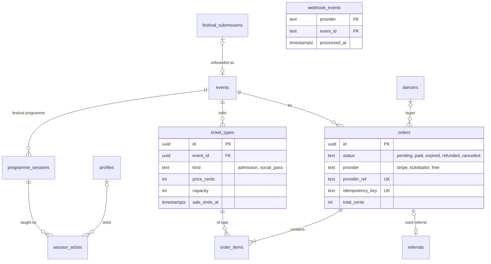

## Context

- **The programme is code.** Workshops, teachers and lineups exist only for the
  festivals hardcoded in `app/data/mock-*.ts`, wired up in
  `app/pages/festivals/[slug].vue:27-34`. A festival that exists only in the
  database has no schedule, no workshop picker and no ticket list (RAZ-36,
  RAZ-54, RAZ-97, RAZ-69).
- **Prices are code.** Ticket tiers, prices, sold-out flags and referral
  percentages live in `server/utils/ticket-prices.ts:25-60`; early-bird data is a
  DB column with a hardcoded fallback (`plan.ts:276-280`). An organiser cannot
  set up ticketing without a deploy (RAZ-33).
- **There is no order.** A payment is a `festival_signups` row with
  `paid_amount` and `stripe_session_id` (`schema.ts:80-81`). What was bought is a
  comma-joined string in Stripe metadata (`festivalSignup.ts:357`).
- **Paid tickets can be lost.** The Stripe webhook inserts a sign-up and treats
  *any* unique-constraint conflict as "already processed"
  (`api/stripe/webhook.post.ts:65-88`). A dancer who first took a free spot
  (`festivalSignup.join`, unverified row) and then buys a ticket hits that
  conflict: the payment is never recorded, `verified_ticket_holder` stays false,
  and no confirmation email is sent (RAZ-110, RAZ-247, RAZ-248).
- **TicketTailor buyers do not see their ticket.** The TicketTailor webhook writes
  `paid_amount = 0` (`tickettailor.lib.ts:150`) while `festivalSignup.myTickets`
  only returns rows with `paid_amount > 0` (`festivalSignup.ts:561`), so the My
  Plan "ticket bought" state never turns on for them (RAZ-99). The event mapping
  is a hardcoded one-entry map (`tickettailor.lib.ts:14-16`).
- **Referral credits can vanish.** Credits are marked consumed by a checkout
  session *when the session is created* (`festivalSignup.ts:384-397`); when that
  session expires unpaid, `expireReferral` (`api/stripe/webhook.lib.ts:39-47`) only
  expires the referee row and never releases the credit.
- **Free spots and the €1 social unlock are special cases**:
  `festivals.max_free_spots` (`schema.ts:60`), a hardcoded `unit_amount: 100`
  (`festivalSignup.ts:162`) and a legacy `stripe_payment_link` column (`61`).
- **Organiser ownership is inferred** from an onboarded submission with the same
  slug (ADR-004), and onboarding a submission into a listing is manual — the admin
  page cannot create a festival (RAZ-95, RAZ-112, RAZ-170 notes).

## Options

1. **Keep prices in code, add only a workshops table.** Fixes the schedule, not
   self-serve ticketing, the order record or the webhook bugs.
2. **Make TicketTailor the only ticketing system** and store just its orders.
   Organisers configure tickets there; WeDance becomes a mirror. Drops the
   one-tap Stripe checkout and referral discounts (RAZ-130, RAZ-23) that are built.
3. **Programme, catalogue and orders in the database**; Stripe and TicketTailor are
   payment channels that write into the same `orders` through an idempotent
   webhook ledger.

## Decision

Option 3.

- **Programme.** `programme_sessions(id, event_id → festival event, title, kind, style, level, starts_at, ends_at, room, capacity, description, sort, source_ref)`
  and `session_artists(id, session_id, profile_id NULL, display_name, sort)`. The
  festival's lineup is `event_artists` on the festival event (ADR-006); the
  session table says who teaches what, when.
- **Catalogue.** `ticket_types(id, event_id, kind, name, description, price_cents, currency, capacity, sale_starts_at, sale_ends_at, status, sort, provider, provider_ref)`
  with `kind` = `admission` (a festival ticket) or `social_pass` (WeDance's own
  social layer: dinners, rides, waves). The free spots become a `social_pass` at
  0 cents with `capacity = 10`, the €1 unlock a second `social_pass` at 100 cents;
  `max_free_spots`, `stripe_payment_link` and `ticket-prices.ts` go away. Early
  bird is a ticket type with a `sale_ends_at`.
- **Orders.** `orders(id, dancer_id NULL, event_id, status, provider, provider_ref, idempotency_key, buyer_email, subtotal_cents, discount_cents, total_cents, currency, referral_id, created_at, paid_at)`
  and `order_items(id, order_id, ticket_type_id, quantity, unit_price_cents)`.
  `status`: `pending` · `paid` · `expired` · `refunded` · `cancelled`.
  `(provider, provider_ref)` and `idempotency_key` are unique.
- **Checkout flow.** The client sends ticket-type ids plus an idempotency key.
  In one transaction the server locks the ticket types, checks capacity against
  paid and unexpired pending items, creates the `pending` order and reserves any
  referrer credit on it; then it creates the Stripe session with
  `client_reference_id = order.id` and Stripe's idempotency key = order id.
- **Webhooks are a ledger.** `webhook_events(provider, event_id, type, received_at, processed_at)`
  with primary key `(provider, event_id)`. A delivery is processed only if its
  insert succeeds; marking the order paid, writing the ticket-holder attendance
  (ADR-008) and completing the referral happen in one transaction; the email goes
  out after commit. `checkout.session.expired` expires the order and releases its
  reserved credit. TicketTailor orders land in the same table
  (`provider = 'tickettailor'`, mapped through
  `festival_details.tickettailor_event_id` instead of the hardcoded map).
- **Referrals** reference the order that used them (`referrals.order_id`) and the
  order that spent the credit (`credit_order_id`); a credit is spent only when that
  order is paid.
- **Ownership and onboarding.** Organisers manage a festival through
  `profile_members` of its `organizer_profile_id` (ADR-004). Approving a
  `festival_submissions` row creates the `events` + `festival_details` rows, links
  `festival_submissions.event_id`, and grants the submitter `owner` on the
  organiser profile — in one admin action.
- **The mock festivals become data.** A one-off, idempotent seed moves the
  festivals, sessions, teachers and ticket types from `app/data/mock-*.ts` and
  `ticket-prices.ts` into these tables (`source = 'wedance'`, `source_ref`
  pointing at the file), after an organiser confirms each festival's data is
  current. Then the files are deleted.

## Consequences

- Organisers can configure a festival without a code change; WeDance can show
  ticket availability honestly.
- Every euro has one row; refunds and reconciliation become queries.
- The two webhook bugs disappear by construction (no "conflict means done", no
  `paid_amount` filter).
- The Stripe account stays in test mode until the Commander switches it
  (`CLAUDE.md` registry note); nothing here changes that.
- Organiser subscriptions (Pro/Network, RAZ-100, RAZ-106) are **not** in this ADR —
  they need a pricing decision first.

## Stories unblocked

RAZ-33 (organisers set up ticketing), RAZ-36, RAZ-54, RAZ-97 (programme for any
festival), RAZ-69 and RAZ-149 (ticket recommendations over real data), RAZ-74
(workshop demand), RAZ-110, RAZ-130, RAZ-246, RAZ-247, RAZ-248 (reliable
purchase state and email), RAZ-99 (TicketTailor tickets visible), RAZ-23
(referral credits not lost), RAZ-144 (early bird as data), RAZ-95, RAZ-112,
RAZ-122, RAZ-141 (submission → listing), RAZ-170 (admin can onboard festivals),
map:meetup-2.2-free-spot-counter and map:meetup-2.3-social-paywall.
