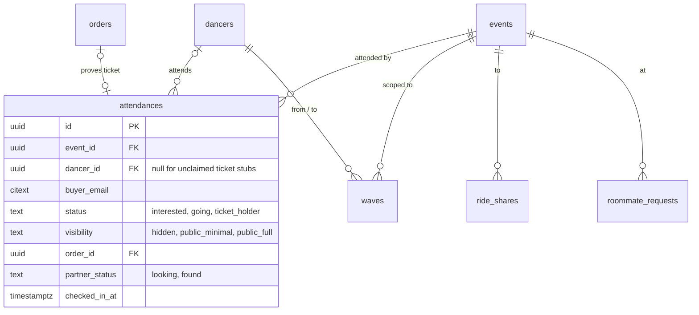

## Context

"Who is going" is answered by two unrelated tables with opposite privacy
defaults, and the product promise "no fake friends" (RAZ-83) depends on which one
a page happens to read.

- **"Going" clicks** are `plan_items` rows with `item_type` `festival`/`event` and
  an opt-in `share_going` flag (`schema.ts:568-573`), **default `false`**
  (`migrations/0020_opt_in_attendees.sql`). Festival cards, Who's Going lists, the
  landing proof card and the discover deck read them (`api/festivals.get.ts:53-57`,
  `plan.ts:150-190`, `912-1030`; RAZ-62, RAZ-77, RAZ-86, RAZ-115).
- **Sign-ups and tickets** are `festival_signups` (`schema.ts:74-97`): a free spot,
  the €1 social unlock, a Stripe ticket or a TicketTailor order, with
  `verified_ticket_holder` and a `roster_visibility` that **defaults to
  `public_minimal`** (`93`). Only one hardcoded festival page shows this roster
  (RAZ-83 notes); organiser insights count it (`festivalInsights.ts:68-79`, RAZ-79).
- **So one festival has two attendee numbers**: the listing counts Going clicks
  (`api/festivals.get.ts:11`), the organiser dashboard counts sign-ups.
- **Faces on most pages come from unverified clicks**, which is what RAZ-83 calls
  fake friends.
- **Waves** reference the festival by slug (`schema.ts:721`), draw candidates from
  `plan_items` (`wave.ts:209-220`) but `wave.send` accepts any dancer id, attending
  or not (`wave.ts:11-26`).
- **Per-festival logistics live in the browser.** "Ticket bought", "travel booked",
  "stay booked", "partner found", "vacation booked" are localStorage toggles
  (`app/pages/my-plan.vue:452-458`), so Match Rate (RAZ-128), Find a Partner
  (RAZ-102) and partner matching (RAZ-61) have no server data.
- **Check-in does not exist** (map:meetup-1.7-activity-check-in).
- **Rides and roommates ignore the dancer's privacy setting** (ADR-003).

## Options

1. **Keep both tables and union them in a view.** No migration, but two visibility
   settings with opposite defaults still have to be reconciled on every read, and
   writes still go to two places.
2. **One `attendances` table** with a status ladder and one visibility setting;
   ticket holders are attendances backed by an order.
3. **Interest stays in plans; attendance is tickets only.** Clean for paid
   festivals, but socials and classes have no tickets, so "going" to a Thursday
   social would have nowhere to live.

## Decision

Option 2.

- **`attendances(id, event_id, dancer_id NULL, buyer_email, status, source, order_id NULL, visibility, partner_status, travel_booked_at, stay_booked_at, vacation_booked_at, checked_in_at, verified_at, created_at, updated_at)`**.
  - `status`: `interested` → `going` → `ticket_holder`. A dancer sets
    `interested`/`going`; only a paid order or a verified TicketTailor order sets
    `ticket_holder` (and `verified_at`). Cancelling a going never removes a ticket.
  - `source`: `click` · `free_pass` · `social_pass` · `stripe` · `tickettailor` · `claim`.
  - Unique `(event_id, dancer_id)`; ticket-holder **stubs** keep `dancer_id NULL` and
    `buyer_email` until a dancer with that *verified* email claims them (ADR-003);
    unique `(event_id, lower(buyer_email))` where `dancer_id IS NULL`.
  - `partner_status` (`looking` · `found`) and the logistics timestamps replace the
    localStorage toggles; `checked_in_at` is set by the organiser's door flow.
- **One visibility setting per attendance**: `hidden` · `public_minimal` (name +
  city) · `public_full` (+ photo). It replaces both `share_going` and
  `roster_visibility`.
- **One public rule**, implemented once (`publicAttendees(eventId)`):
  a dancer appears in any public list only if `status IN ('going','ticket_holder')`,
  `visibility <> 'hidden'` and `dancers.profile_public`. Ticket holders carry a
  "verified" badge; counts report `going` and `ticket_holder` separately so a page
  can never present clicks as tickets. Hidden attendees are counted, never listed.
- **Waves, rides and roommates hang off attendance**: `waves(event_id, from_dancer_id, to_dancer_id)`
  with an FK to `events`; sending a wave requires both dancers to have a visible
  attendance for that event. Ride shares and roommate requests use `event_id` and
  the same public rule.
- **Backfill** (both sources into one row per dancer and event, taking the higher
  status and the *more private* visibility when they disagree):
  - `plan_items` `festival`/`event` → `going`; `share_going = true` →
    `public_full` (today's list shows photos), else `hidden`. Course enrolments
    (`metadata.type = 'class'`) go to `series_enrolments` instead (ADR-009).
  - `festival_signups` verified → `ticket_holder` with `roster_visibility`; paid
    but unverified (€1 unlock, free spot) → `going` with a `social_pass` order
    (ADR-007); stubs keep `buyer_email`.
  - `plan_items` whose `item_id` is a booking id map to the event created from that
    booking if it was accepted, otherwise they are reported and left out.

## Consequences

- One number per event for "going" and one for "verified", everywhere.
- Organiser insights and the public roster finally describe the same people.
- The default visibility for new attendances is a product decision (see open
  questions); this ADR recommends `hidden` (today's `share_going` default), with
  an explicit prompt after the click.
- The two existing opt-in UIs (RAZ-115 and the ticket roster) collapse into one
  control.

## Stories unblocked

RAZ-83 (no fake friends), RAZ-62, RAZ-86, RAZ-115, RAZ-34, RAZ-77 (one
attendee list), RAZ-79 and RAZ-150 (insights on the same attendees), RAZ-82,
RAZ-65, RAZ-61, RAZ-124 (waves between real attendees), RAZ-102 and RAZ-128
(partner status on the server), RAZ-99 (ticket state from orders),
map:meetup-1.7-activity-check-in, map:meetup-8.3-next-festival-invite (who you
met is now queryable).
