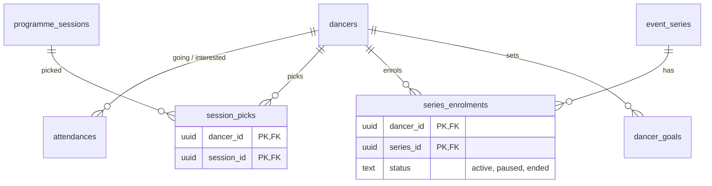

## Context

`plan_items` (`schema.ts:561-580`) stores four different things behind
`(item_type, item_id text)`:

| item_type | what `item_id` holds | evidence |
|---|---|---|
| `festival` | a festival **slug** | `plan.ts:209-228` joins on `festivals.slug` |
| `event` | an `events.id` **or** a `booking_requests.id` (both are "events", ADR-006) | `plan.ts:987-998`, `app/pages/events/[id].vue:41-45` |
| `workshop` | `'<festivalSlug>:<mock workshop id>'` — an id from `app/data/mock-*.ts` | `plan.ts:232-250` |
| `goal` | a client-generated goal id, the goal itself in `metadata` | RAZ-91 notes |

- Nothing guarantees `item_id` points at anything; `plan.add` accepts any string of
  any length (`plan.ts:76-97`), and the public `plan.count` will count rows for
  any `(type, id)` pair.
- Courses are copied into `metadata` at enrolment (`app/pages/my-plan.vue:1047-1048`),
  so a weekly class becomes one frozen occurrence whose details never update
  (RAZ-108, RAZ-287).
- Workshop picks are stored twice: the festival page writes `plan_items`, the My
  Plan workshop picker reads and writes localStorage (`my-plan.vue:466`; RAZ-97).
- A goal is not something you attend, but it shares the uniqueness key and the
  `share_going` flag with things you attend (RAZ-91 notes).
- "Going" itself moves to `attendances` (ADR-008), which removes `festival` and
  `event` from this table's job.

## Options

1. **Keep the polymorphic table, validate in a trigger.** One table, but every
   query still branches on `item_type`, no FK can exist, and deleting an event
   leaves dangling rows.
2. **Constrained polymorphic association (exclusive arc)**: one row type with
   nullable `event_id`, `session_id`, `series_id`, `goal_id` FKs and a
   `num_nonnulls(...) = 1` check. Real FKs, one table — but the rows still have
   different lifecycles, uniqueness rules and columns (a goal has a target and a
   period; a course enrolment has a status), which end up as nullable columns
   meaningful for one type each.
3. **One table per kind of plan entry**, each with its own FK and constraints.
   "My plan" becomes a query (or view) over them.

## Decision

Option 3. The plan entries are different things that only share a page.

- **Going / interested in an event or festival** → `attendances` (ADR-008).
- **Workshop picks** → `session_picks(dancer_id, session_id, created_at)`,
  primary key `(dancer_id, session_id)`, `session_id` FK to `programme_sessions`
  (ADR-007), `ON DELETE CASCADE`. localStorage stops being a store; the picker
  reads and writes this table only.
- **Course enrolment** → `series_enrolments(dancer_id, series_id, status, enrolled_at, ended_at)`,
  primary key `(dancer_id, series_id)`, FK to `event_series` (ADR-006). The
  course's details are read from the series, never copied. Payment state for
  courses ("pay due", RAZ-287) is added when course payments exist, as orders
  against the series.
- **Goals** → `dancer_goals(id, dancer_id, kind, title, target, period_year, metadata jsonb, created_at, updated_at)`.
- **The plan view.** `plan.mine` returns one typed union built from these tables
  (attendances + session picks + enrolments + goals); a SQL view
  `dancer_plan_v` exists for reporting only.
- **Backfill** maps each `plan_items` row by type: festival slug → festival event
  id (`festival_details.legacy_festival_id`/slug), event id → `events.id` (booking
  ids via `booking_requests.event_id`), workshop id → `programme_sessions.id` via
  the seeded mock sessions' `source_ref`, goal → `dancer_goals` with its metadata.
  Rows that cannot be mapped are written to a report table, never dropped
  silently. `plan_items` is dropped after reads have moved and the report is empty
  or accepted.

## Consequences

- Every plan entry has a real target and disappears with it.
- Weekly classes stay current: changing a series' time changes every enrolled
  dancer's plan.
- Workshop demand per session is a `GROUP BY session_id` (RAZ-74).
- The client composables (`useWeekPlan`, `useYearPlan`) change from one generic
  `plan.add(itemType, itemId)` to typed calls; the migration keeps the old
  procedures as adapters for one release.

## Stories unblocked

RAZ-97, RAZ-36, RAZ-54 (one workshop store), RAZ-74 (workshop demand),
RAZ-108, RAZ-113, RAZ-287 (courses as live series), RAZ-91 (goals as their own
records), RAZ-140 (workshop counts by FK), map:schedule-compare-with-friends
(friends' picks are comparable server-side).
