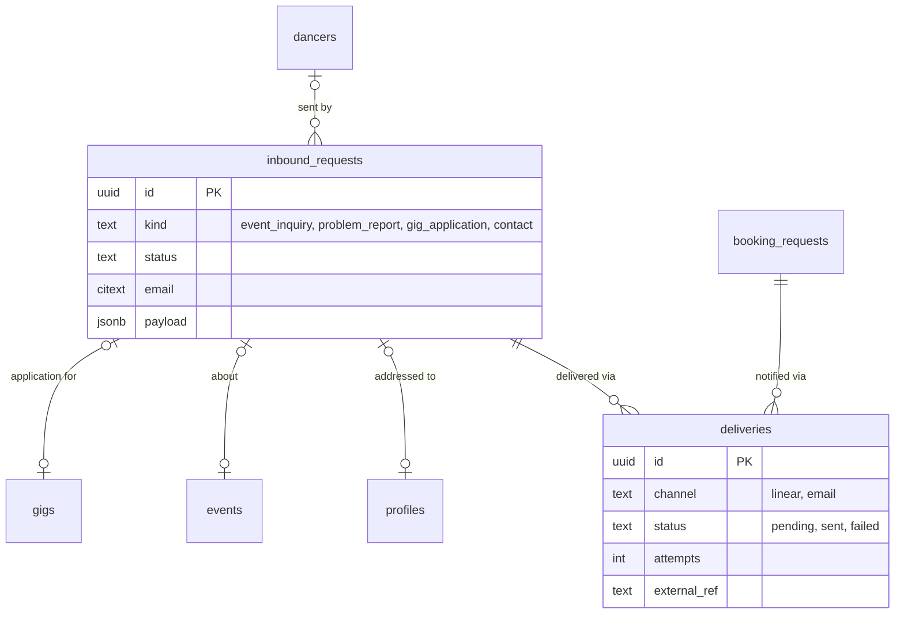

## Context

- **Event enquiries are not stored.** `feedback.inquiry` (`routers/feedback.ts:119-160`)
  turns the /for-events form into a Linear issue and keeps nothing. If Linear is
  down or `LINEAR_API_KEY` is unset (`feedback.ts:48-49`) the customer's request is
  lost; the customer's name and email live only in a third-party tracker. Thirteen
  built stories route through it (RAZ-57, RAZ-63, RAZ-68, RAZ-73, RAZ-78, RAZ-81,
  RAZ-90, RAZ-96, RAZ-101, RAZ-107, RAZ-114, RAZ-138, RAZ-143).
- **Problem reports** (`feedback.report`, `feedback.ts:162-248`) are the same:
  Linear only, including a screenshot of up to 6.5 MB.
- **Gig applications are `mailto:` links** to `gigs.contact_email` (RAZ-41 notes);
  nothing is recorded, "confirmation sent" is client-side, and the poster's email
  is public (ADR-003).
- **Booking requests are stored but delivered to no one** (`booking.ts:222-243`;
  RAZ-129, RAZ-135 notes): the venue is never notified.
- The Linear team id is hardcoded (`feedback.ts:24`) and the team was renamed once
  already (`WED` → `RAZ`, ikigai `CLAUDE.md` "Task tracking").

## Options

1. **Keep Linear as the store.** Zero code, but no retry, no status for the
   customer, no notification to venues or gig posters, and customer PII in a dev
   tool.
2. **A table per request type** (`event_inquiries`, `problem_reports`,
   `gig_applications`). Precise columns, but the triage, delivery and retry logic
   is identical and would be written three times.
3. **One `inbound_requests` table** (typed by `kind`, typed subject FKs, payload
   in `jsonb`) plus a small delivery outbox that pushes to Linear and email.

## Decision

Option 3. Booking requests keep their own table (they have a real workflow with
availability and a decision, ADR-006); they use the same delivery outbox.

- **`inbound_requests(id, kind, status, dancer_id NULL, email, name, event_id NULL, profile_id NULL, gig_id NULL, payload jsonb, created_at, updated_at)`**
  - `kind`: `event_inquiry` · `problem_report` · `gig_application` · `contact`.
  - `status`: `new` · `triaged` · `in_progress` · `answered` · `closed` · `spam`.
  - Subject FKs form an exclusive arc where applicable (a gig application must
    have `gig_id`; a report has none).
  - Screenshots go to object storage (the Cloudinary account already used for
    avatars) and the row stores the URL, not the image.
- **`deliveries(id, subject_type, subject_id, channel, target, status, attempts, last_error, external_ref, created_at, delivered_at)`** — the
  outbox. `channel`: `linear` · `email`. Writing the request and its delivery rows
  is one transaction; a scheduled job (Vercel cron, every few minutes) sends due
  deliveries with backoff and stores `external_ref` (the Linear issue identifier
  or the email message id).
- **Who receives what**
  - `event_inquiry`, `problem_report` → Linear (team id from runtime config, not
    code) + an internal email.
  - `gig_application` → email to the gig poster (address never shown publicly);
    the applicant gets a real confirmation.
  - New `booking_requests` → email to the venue's members (ADR-004), or to the
    space's moderators for free commons; `booking_requests.notified_at` records it.
- **Rate limits and spam** use the ADR-003 middleware; `status = 'spam'` keeps the
  row for pattern detection.
- **Retention**: closed requests older than 24 months are anonymised (name, email
  and payload PII cleared) by the same scheduled job.

## Consequences

- No enquiry is lost when Linear or the email provider is down.
- Venues and gig posters start receiving what is sent to them, which is what the
  booking and gigs stories promise.
- WeDance becomes the record of customer contact, with a retention rule.
- A cron job is new infrastructure; it is a Vercel cron hitting a protected Nitro
  route, no new service.

## Stories unblocked

RAZ-41 (apply with a stored, delivered application), RAZ-42 (poster can see
applications), RAZ-129, RAZ-135, RAZ-142, RAZ-158 (venues are notified),
RAZ-57, RAZ-63, RAZ-107, RAZ-114 and the other /for-events stories (enquiries
cannot be lost; same-day reply measurable, RAZ-111), RAZ-272 (reports stored).
