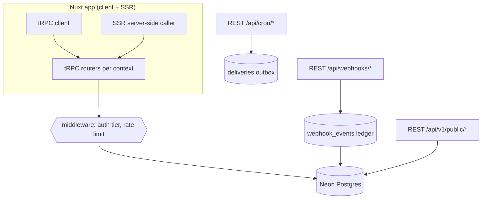

## Context

The API is 26 tRPC routers with 127 procedures (13 admin) plus 12 REST handlers
(`server/trpc/index.ts:29-56`; the generated /architecture/api page). It grew one
feature at a time:

- **Routers follow features, not contexts.** `entity` serves professional
  profiles and `profile` serves dancers (`entity.ts:6-11`, `profile.ts:8-17`);
  `festivalSignup` mixes free spots, two checkouts, the roster and visibility
  (`festivalSignup.ts`); booking moderation lives in `election`
  (`election.ts:373-408`); `plan` (1,098 lines) holds going lists, the discover
  deck, festival suggestions and the landing proof card.
- **Errors leak as 500s.** Bare `throw new Error(...)` becomes
  `INTERNAL_SERVER_ERROR` (`festivalSignup.ts:82`, `93`, `125`, `133`, `146`;
  `dinner.ts:103`, `112`; `communityGroup.ts:87`, `91`, `104`). Unique violations
  are detected by searching error *messages* for "unique"/"duplicate"
  (`api/stripe/webhook.post.ts:76-81`, `dinner.ts:121-126`, `giveaway.ts:77-79`,
  `festivalSignup.ts:103-108`) — the root of the lost-payment bug in ADR-007.
- **No pagination.** `entity.listArtists`, `listVenues` and `listCities` return
  every matching profile (`entity.ts:14-68`); `gigs.list` returns every open gig
  (`gigs.ts:35-41`); `/api/cities` scans all visible profiles per request
  (`api/cities.get.ts:24-28`).
- **N+1 queries.** `dinner.list` runs up to three queries per dinner
  (`dinner.ts:34-90`); `hangouts.listTonight` one per hangout (`hangouts.ts:41-60`).
- **Whole rows leave the server.** `gigs.list`/`getById` `select()` everything,
  including the poster's email (`gigs.ts:20-57`).
- **Inputs without bounds.** `plan.add.itemId` (`plan.ts:80`), `hangouts.create.title`
  (`hangouts.ts:69`), most `gigs.create` fields (`gigs.ts:62-76`) and
  `review.create.targetSlug` (`review.ts:102`) have no maximum length.
- **Toggles are not retry-safe.** `follow.toggle`, `hangouts.toggleRsvp`,
  `roommate.toggle` flip state, so a retried request undoes itself.
- **Auth tiers are ad hoc.** `referral.myReferrals` is public and returns an empty
  list when signed out (`referral.ts:63-66`); ownership checks are hand-written per
  router (ADR-004).
- **REST duplicates tRPC for SSR.** `/api/cities` "mirrors trpc
  entity.listCities" because the tRPC client is client-only (`api/cities.get.ts:6-10`);
  `/api/festivals` does the same for festivals.

## Options

1. **Keep the flat router list** and fix bugs case by case. Every new feature keeps
   picking its own conventions.
2. **Move to REST/OpenAPI** for everything. Gains public documentation, loses
   end-to-end types for a single Nuxt client that ships with its server.
3. **Keep tRPC as the internal API with written conventions**; REST only where a
   third party or a non-Nuxt client is the caller.

## Decision

Option 3. The conventions:

- **Router per bounded context**, matching `scripts/architecture/domains.ts`:
  `identity` · `dancers` · `profiles` · `directory` · `events` · `festivals` ·
  `ticketing` · `attendance` · `plans` · `social` · `booking` · `governance` ·
  `community` · `opportunities` · `inbound` · `organizer` · `admin`.
  A context with more than one resource nests one level
  (`social.waves.send`, `booking.requests.decide`); otherwise `context.verb`.
- **Names.** Queries: `get` (one, by id or slug), `list` (paged), `count`, or a
  specific read (`byCity`, `roster`). Mutations: `create`, `update`, `delete` or a
  domain verb (`checkout`, `claim`, `castVote`, `decide`). Set-state mutations are
  idempotent pairs (`follow`/`unfollow`, `rsvp`/`unrsvp`), never toggles.
- **Auth tiers as middleware**, one per level, composable:
  `publicProcedure` → `authedProcedure` (valid session) →
  `verifiedProcedure` (verified email, ADR-003) → `memberProcedure(roles)`
  (a `profile_members` role on the profile named in the input, ADR-004) →
  `adminProcedure`. Plus `rateLimited(name, limit, window)` for public writes.
  Procedures that need a session never use `publicProcedure` with an internal
  `if (!ctx.dancerId)`.
- **Errors.** Only `TRPCError` with a code. A shared `dbError(e)` maps SQLSTATE
  (`23505` → `CONFLICT` with the constraint name, `23503` → `BAD_REQUEST`, `23514`
  → `BAD_REQUEST`) — never message matching. An `errorFormatter` returns zod
  issues as field errors (the valibot client forms already show them); 5xx are
  reported to Sentry (`@sentry/nuxt` is installed).
- **Inputs.** Every string has a max length, every array a max size, ids are
  `uuid()`, closed sets come from the shared enum arrays (ADR-002). zod schemas for
  shared shapes live next to the valibot form schemas in `shared/validation/`.
- **Outputs.** Every procedure selects explicit columns into a named DTO type.
  Public DTOs never contain email addresses, contact details, private messages or
  dancers hidden by the ADR-008 rule. Times are ISO-8601 instants plus the
  event's IANA zone.
- **Pagination is cursor-based** (keyset): input `{ cursor?: string, limit?: 1..100 = 30 }`,
  output `{ items, nextCursor: string | null }`, cursor = opaque base64 of the
  sort key and id. Matches tRPC's `useInfiniteQuery`. Offset pagination is not
  used (it skips or repeats rows while the v3 sync writes).
- **Atomic writes.** A mutation that writes more than one statement uses
  `withTx` (ADR-002). No N+1: lists join or batch (`inArray`) in at most a fixed
  number of queries.
- **Idempotency.** Checkout takes a client `idempotencyKey` (unique on `orders`);
  creates guarded by a natural unique key use `ON CONFLICT DO NOTHING … RETURNING`;
  webhooks go through the `webhook_events` ledger (ADR-007).
- **SSR uses tRPC on the server** through a server-side caller
  (`appRouter.createCaller(ctx)` in a server-only Nuxt plugin), so `/api/cities`,
  `/api/cities/:slug` and `/api/festivals*` retire. Anonymous public queries send
  `Cache-Control: s-maxage=60, stale-while-revalidate=300` via `responseMeta`.
- **What stays REST**:
  - webhooks (`/api/webhooks/stripe`, `/api/webhooks/tickettailor` — the Stripe
    handler moves under `webhooks/`),
  - multipart upload (`/api/media/image`),
  - scheduled jobs (`/api/cron/*`, protected by `CRON_SECRET`),
  - public read-only feeds for third parties — the organiser embed widget
    (map:meetup-1.8) and iCal feeds — under **`/api/v1/public/…`**,
  - the generated architecture admin JSON.
  The Google Places proxies (`/api/city-search`, `/api/city-options`,
  `/api/city-resolve`) move into `directory.cities.*` so they share the rate-limit
  middleware.
- **Versioning.** tRPC is internal: client and server deploy together, so it is
  not versioned; breaking changes follow expand/contract (add the new procedure,
  move callers, delete the old one a release later). Public REST is versioned in
  the path; `/api/v1` never breaks, a breaking change is `/api/v2`.

## Consequences

- Procedure renames are mechanical but touch every caller; they ship context by
  context with adapters (old names delegate to new ones) for one release.
- The target catalogue is in `/architecture/decisions/api-plan`.
- Public embed and iCal endpoints become possible without exposing tRPC.

## Stories unblocked

map:meetup-1.8-organizer-embed-widget (versioned public feed), RAZ-104 (iCal
instead of a Google-only link), RAZ-58 and RAZ-64 (paged, filterable artist
search), RAZ-41 (no public poster email), RAZ-118 (no N+1 on the Tonight list).
