This is the schema that ADR-001 to ADR-011 add up to. It keeps the stack (Nuxt 4,
tRPC, Drizzle, Neon Postgres, Vercel) and every row of production data. The path
from today's schema to this one is
[the migration plan](/architecture/decisions/migration-plan); the decisions behind
each shape are linked per context.

**Conventions used in every table** (ADR-002): `uuid` primary keys
(`gen_random_uuid()`); `created_at`/`updated_at` are `timestamptz NOT NULL DEFAULT now()`
(`updated_at` maintained by one trigger); every FK has an explicit `ON DELETE` and
an index; closed value sets are `text` + `CHECK`; scalar lists are `text[]` (GIN
index where filtered); documents are `jsonb`; emails and handles are `citext`
(extension `citext`). Columns listed below omit `created_at`/`updated_at` unless
they matter.

## Overview

```mermaid
erDiagram
  dancers ||--o{ sessions : ""
  dancers ||--o{ auth_tokens : ""
  handles |o--o| dancers : ""
  handles |o--o| profiles : ""
  dancers ||--o{ dancer_styles : ""
  dance_styles ||--o{ dancer_styles : ""
  cities ||--o{ dancers : ""
  cities ||--o{ profiles : ""
  cities ||--o{ events : ""
  profiles ||--o{ profile_members : ""
  dancers ||--o{ profile_members : ""
  profiles ||--o{ profile_claims : ""
  profiles ||--o{ profile_affiliations : ""
  profiles ||--o{ follows : ""
  dancers ||--o{ follows : ""
  event_series ||--o{ events : ""
  profiles |o--o{ events : "venue / organiser"
  events ||--o{ event_artists : ""
  profiles |o--o{ event_artists : ""
  events ||--o| festival_details : ""
  events ||--o{ programme_sessions : ""
  programme_sessions ||--o{ session_artists : ""
  events ||--o{ ticket_types : ""
  events ||--o{ orders : ""
  orders ||--|{ order_items : ""
  ticket_types ||--o{ order_items : ""
  dancers |o--o{ orders : ""
  orders |o--o| referrals : ""
  events ||--o{ attendances : ""
  dancers |o--o{ attendances : ""
  orders |o--o| attendances : ""
  events ||--o{ waves : ""
  events ||--o{ ride_shares : ""
  events ||--o{ roommate_requests : ""
  events ||--o{ dinners : ""
  dinners ||--o{ dinner_signups : ""
  dinners ||--o{ dinner_groups : ""
  dinner_groups ||--o{ dinner_group_members : ""
  dancers ||--o{ session_picks : ""
  programme_sessions ||--o{ session_picks : ""
  dancers ||--o{ series_enrolments : ""
  event_series ||--o{ series_enrolments : ""
  dancers ||--o{ dancer_goals : ""
  profiles ||--o{ bookable_spaces : ""
  bookable_spaces ||--o{ availability_slots : ""
  bookable_spaces ||--o{ booking_requests : ""
  booking_requests |o--o| events : ""
  profiles ||--o{ moderator_elections : ""
  moderator_elections ||--o{ election_candidates : ""
  election_candidates ||--o{ election_votes : ""
  moderator_elections ||--o{ election_vote_history : ""
  profiles ||--o{ guideline_versions : ""
  cities ||--o{ city_videos : ""
  city_videos ||--o{ video_votes : ""
  cities ||--o{ city_battle_votes : ""
  cities ||--o{ giveaways : ""
  giveaways ||--o{ giveaway_entries : ""
  events |o--o{ reviews : ""
  profiles |o--o{ reviews : ""
  cities ||--o{ recommendation_requests : ""
  cities ||--o{ community_groups : ""
  community_groups ||--o{ community_group_reports : ""
  profiles |o--o{ gigs : ""
  cities |o--o{ gigs : ""
  cities ||--o{ hangouts : ""
  hangouts ||--o{ hangout_rsvps : ""
  festival_submissions |o--o| events : ""
  inbound_requests ||--o{ deliveries : ""
  gigs |o--o{ inbound_requests : ""
```

## Identity — [ADR-003](/architecture/decisions/003-security-hygiene), [ADR-004](/architecture/decisions/004-identity-and-profile-ownership)

### dancers (kept, changed)

| Column | Type | Constraints / notes |
|---|---|---|
| id | uuid | PK |
| email | citext | NOT NULL, UNIQUE |
| email_verified_at | timestamptz | new; set when a login/verify token is consumed |
| name | text | NOT NULL |
| photo_url | text | renamed from `photo` |
| city_id | uuid | FK `cities` ON DELETE SET NULL; replaces `city` (ADR-005) |
| partner_role | text | CHECK IN (`lead`,`follow`,`both`); renamed from `role` |
| bio, instagram, youtube, website | text | lengths checked |
| profile_public | boolean | NOT NULL DEFAULT true |
| password_salt, password_hash | text | NULL = no password (no `''` sentinel) |
| intent | text | CHECK against the onboarding persona list |
| onboarded_at | timestamptz | |
| is_admin | boolean | NOT NULL DEFAULT false |
| neon_auth_id | text | UNIQUE; kept for a future provider (ADR-003) |
| source_ref | jsonb | added to `schema.ts` (exists in prod, `00-schema.mjs:5`) |

Removed: `username` (→ `handles`), `magic_token*` (→ `auth_tokens`),
`dance_styles`/`dance_levels` (→ `dancer_styles`), `city`, `role`, `photo`.

### dancer_styles (new)

| Column | Type | Constraints / notes |
|---|---|---|
| dancer_id | uuid | PK, FK `dancers` ON DELETE CASCADE |
| style_key | text | PK, FK `dance_styles` ON DELETE RESTRICT |
| level | text | CHECK IN (`Beginner`,`Intermediate`,`Advanced`) or NULL |

Index: `(style_key, level)` for the organiser style-and-level mix (RAZ-79).

### sessions (kept, changed)

| Column | Type | Constraints / notes |
|---|---|---|
| id | uuid | PK |
| dancer_id | uuid | NOT NULL, FK `dancers` ON DELETE CASCADE, indexed |
| token_hash | bytea | NOT NULL, UNIQUE (SHA-256); replaces plaintext `token` |
| expires_at | timestamptz | NOT NULL |
| last_seen_at, revoked_at | timestamptz | |
| user_agent | text | |

### auth_tokens (new)

| Column | Type | Constraints / notes |
|---|---|---|
| id | uuid | PK |
| dancer_id | uuid | FK `dancers` ON DELETE CASCADE; NULL for a sign-up not yet consumed |
| email | citext | NOT NULL |
| purpose | text | CHECK IN (`login`,`reset_password`,`verify_email`) |
| token_hash | bytea | NOT NULL, UNIQUE |
| payload | jsonb | sign-up fields, applied on consume |
| expires_at | timestamptz | NOT NULL |
| used_at | timestamptz | single use |

Index: `(email, purpose)`; expired rows purged daily.

### handles (new)

| Column | Type | Constraints / notes |
|---|---|---|
| handle | citext | PK; CHECK format `^[a-z0-9][a-z0-9._-]{1,39}$`, not in reserved list |
| dancer_id | uuid | UNIQUE, FK `dancers` ON DELETE CASCADE |
| profile_id | uuid | UNIQUE, FK `profiles` ON DELETE CASCADE |
| | | CHECK `num_nonnulls(dancer_id, profile_id) = 1` |

### rate_limits (new, platform)

| Column | Type | Constraints / notes |
|---|---|---|
| key | text | PK part — procedure + IP (+ email for auth) |
| window_start | timestamptz | PK part |
| hits | integer | NOT NULL DEFAULT 0 |

## Profiles and places — [ADR-004](/architecture/decisions/004-identity-and-profile-ownership), [ADR-005](/architecture/decisions/005-places-cities-and-venues)

### profiles (kept, changed)

| Column | Type | Constraints / notes |
|---|---|---|
| id | uuid | PK |
| type | text | CHECK IN (`venue`,`artist`,`organizer`) |
| roles | text[] | NOT NULL DEFAULT '{}'; CHECK ⊆ role vocabulary; GIN |
| name | text | NOT NULL |
| city_id | uuid | FK `cities` ON DELETE SET NULL; replaces `city`, `city_slug` |
| photo_url, bio, map_url, guidelines | text | |
| styles, languages, amenities | text[] | NOT NULL DEFAULT '{}'; GIN on `styles`, `amenities` |
| address_line, postal_code | text | venues |
| country_code | char(2) | |
| lat, lng | double precision | |
| google_place_id | text | UNIQUE where not null |
| floor_type, venue_type | text | CHECK vocabularies |
| booking_model | text | CHECK IN (`free`,`commercial`) NOT NULL DEFAULT `commercial` |
| socials | jsonb | list of `{platform, url}` |
| status | text | CHECK IN (`visible`,`hidden`,`stub`) NOT NULL DEFAULT `visible` |
| claimed_at | timestamptz | replaces `claimed` boolean |
| source_ref | jsonb | provenance (v4/v3) |

Removed: `username` (→ `handles`), `moderator_name/handle/since` (→
`profile_members` role `moderator`), `address` (after reads move to the
structured columns), `claimed`, `city`, `city_slug`.
Indexes: `(type, city_id) WHERE status = 'visible'`.

### profile_members (new)

| Column | Type | Constraints / notes |
|---|---|---|
| profile_id | uuid | PK, FK `profiles` ON DELETE CASCADE |
| dancer_id | uuid | PK, FK `dancers` ON DELETE CASCADE, indexed |
| role | text | PK; CHECK IN (`owner`,`editor`,`moderator`) |
| term_start, term_end | date | moderator terms |
| granted_by | uuid | FK `dancers` ON DELETE SET NULL |
| granted_at | timestamptz | NOT NULL DEFAULT now() |

### profile_claims (new)

| Column | Type | Constraints / notes |
|---|---|---|
| id | uuid | PK |
| profile_id | uuid | NOT NULL, FK `profiles` ON DELETE CASCADE |
| dancer_id | uuid | NOT NULL, FK `dancers` ON DELETE CASCADE |
| status | text | CHECK IN (`pending`,`approved`,`rejected`) |
| method | text | CHECK IN (`admin_review`) (more later) |
| evidence | text | |
| decided_by | uuid | FK `dancers` ON DELETE SET NULL |
| decided_at | timestamptz | |

Unique: one `pending` claim per `(profile_id, dancer_id)`.

### profile_affiliations (new)

| Column | Type | Constraints / notes |
|---|---|---|
| artist_profile_id | uuid | PK, FK `profiles` ON DELETE CASCADE |
| organizer_profile_id | uuid | PK, FK `profiles` ON DELETE CASCADE |
| kind | text | PK; CHECK IN (`teaches_at`,`resident`,`member`) |

### follows (renamed from `artist_follows`, merged with legacy `follows`)

| Column | Type | Constraints / notes |
|---|---|---|
| dancer_id | uuid | PK, FK `dancers` ON DELETE CASCADE |
| profile_id | uuid | PK, FK `profiles` ON DELETE CASCADE, indexed |
| source_ref | jsonb | v4 provenance for merged edges |

`legacy_follows` keeps unresolved v4 edges (dancer → dancer handle) until the
product decides on dancer-to-dancer follows.

### cities (kept; applied to production in step 11)

As in `schema.ts:739-759` (Google place id, slug, English and local name, country,
region, lat/lng, `alt_names`), with `alt_names` as `text[]` (GIN) instead of `jsonb`.

### dance_styles (new)

| Column | Type | Constraints / notes |
|---|---|---|
| key | text | PK (e.g. `salsa-cubana`) |
| label | text | NOT NULL |
| family | text | e.g. `salsa`, `bachata`, `kizomba` |
| sort | integer | |

Seeded from `docs/research/2026-10-12-dance-styles.md` and the v3 `STYLE_MAP`.
`text[]` style columns on events and profiles are validated against it in the
write path.

## Events and festivals — [ADR-006](/architecture/decisions/006-one-event-model), [ADR-007](/architecture/decisions/007-festival-programme-and-ticketing)

### events (kept, reshaped)

| Column | Type | Constraints / notes |
|---|---|---|
| id | uuid | PK |
| slug | text | NOT NULL, UNIQUE |
| title | text | NOT NULL (renamed from `name`) |
| kind | text | CHECK IN (`social`,`party`,`class`,`course`,`workshop`,`festival`,`congress`,`weekender`,`concert`,`show`,`private`) |
| status | text | CHECK IN (`draft`,`published`,`cancelled`,`archived`); replaces `archived` + `published` |
| description | text | |
| cover_url | text | |
| starts_at, ends_at | timestamptz | CHECK `ends_at >= starts_at` |
| timezone | text | NOT NULL when `status = 'published'` (CHECK) |
| series_id | uuid | FK `event_series` ON DELETE SET NULL |
| city_id | uuid | FK `cities` ON DELETE SET NULL |
| venue_profile_id | uuid | FK `profiles` ON DELETE SET NULL |
| space_id | uuid | FK `bookable_spaces` ON DELETE SET NULL |
| venue_name, venue_address | text | snapshot when no venue profile |
| venue_lat, venue_lng | double precision | |
| organizer_profile_id | uuid | FK `profiles` ON DELETE SET NULL |
| organizer_name | text | snapshot |
| styles | text[] | NOT NULL DEFAULT '{}', GIN |
| price_text | text | display text (was `price`) |
| price_from_cents | integer | CHECK ≥ 0 |
| currency | char(3) | |
| ticket_url, link | text | |
| source | text | CHECK IN (`wedance`,`wedance-v3`,`wedance-v4`,`booking`) NOT NULL |
| source_id | text | UNIQUE with `source` |
| source_ref | jsonb | |
| sync_locked_at | timestamptz | sync stops overwriting once set |
| synced_at | timestamptz | |
| created_by | uuid | FK `dancers` ON DELETE SET NULL |

Removed: `is_festival` (= `kind`), `archived`, `published`, `city`, `city_slug`,
`country`, `venue_username`, `organizer_username`, `artists`, `type`, text `series_id`.
Indexes: `(city_id, starts_at) WHERE status = 'published'`, `(venue_profile_id, starts_at)`,
`(organizer_profile_id, starts_at)`, `(series_id)`, `(kind, starts_at)`.

### event_series (new)

| Column | Type | Constraints / notes |
|---|---|---|
| id | uuid | PK |
| title | text | NOT NULL |
| kind | text | same CHECK as `events.kind` |
| rrule | text | RFC 5545; NULL for irregular series |
| timezone | text | NOT NULL |
| city_id, venue_profile_id, organizer_profile_id | uuid | FKs ON DELETE SET NULL |
| status | text | CHECK IN (`active`,`paused`,`ended`) |
| source, source_id | text | UNIQUE pair (v3 `seriesId`) |

### event_artists (new)

| Column | Type | Constraints / notes |
|---|---|---|
| id | uuid | PK |
| event_id | uuid | NOT NULL, FK `events` ON DELETE CASCADE |
| profile_id | uuid | FK `profiles` ON DELETE SET NULL, indexed |
| display_name | text | NOT NULL (name as listed upstream) |
| role | text | CHECK IN (`teacher`,`dj`,`performer`,`mc`,`band`,`host`) |
| sort | integer | NOT NULL DEFAULT 0 |

Unique `(event_id, profile_id) WHERE profile_id IS NOT NULL`.

### festival_details (new, replaces `festivals`)

| Column | Type | Constraints / notes |
|---|---|---|
| event_id | uuid | PK, FK `events` ON DELETE CASCADE |
| legacy_festival_id | uuid | UNIQUE (old `festivals.id`, for backfills) |
| logo_url | text | |
| accent_color | text | CHECK hex colour |
| early_bird_deadline | date | display; prices live in `ticket_types` |
| early_bird_offer_name | text | |
| tickettailor_event_id | text | UNIQUE; replaces the hardcoded map |

### programme_sessions (new)

| Column | Type | Constraints / notes |
|---|---|---|
| id | uuid | PK |
| event_id | uuid | NOT NULL, FK `events` ON DELETE CASCADE |
| title | text | NOT NULL |
| kind | text | CHECK IN (`workshop`,`class`,`bootcamp`,`show`,`party`,`talk`) |
| style_key | text | FK `dance_styles` ON DELETE SET NULL |
| level | text | CHECK IN (`Beginner`,`Intermediate`,`Advanced`,`Open`) |
| starts_at, ends_at | timestamptz | NOT NULL |
| room | text | |
| capacity | integer | CHECK > 0 |
| description | text | |
| sort | integer | |
| source_ref | jsonb | mock file + id for the seed |

Index: `(event_id, starts_at)`.

### session_artists (new)

| Column | Type | Constraints / notes |
|---|---|---|
| id | uuid | PK |
| session_id | uuid | NOT NULL, FK `programme_sessions` ON DELETE CASCADE |
| profile_id | uuid | FK `profiles` ON DELETE SET NULL |
| display_name | text | NOT NULL |
| sort | integer | |

### festival_submissions (kept, changed)

| Column | Type | Constraints / notes |
|---|---|---|
| id | uuid | PK |
| slug, name | text | |
| submitted_by | uuid | FK `dancers` ON DELETE SET NULL |
| submitted_by_email | citext | |
| payload | jsonb | was `json` |
| status | text | CHECK IN (`pending`,`reviewing`,`onboarded`,`declined`) |
| event_id | uuid | FK `events` ON DELETE SET NULL, UNIQUE |
| reviewed_by | uuid | FK `dancers` ON DELETE SET NULL |
| reviewed_at | timestamptz | |

## Ticketing — [ADR-007](/architecture/decisions/007-festival-programme-and-ticketing)

### ticket_types (new)

| Column | Type | Constraints / notes |
|---|---|---|
| id | uuid | PK |
| event_id | uuid | NOT NULL, FK `events` ON DELETE CASCADE |
| kind | text | CHECK IN (`admission`,`social_pass`) |
| name | text | NOT NULL; UNIQUE with `event_id` |
| description | text | |
| price_cents | integer | NOT NULL, CHECK ≥ 0 |
| currency | char(3) | NOT NULL DEFAULT `EUR` |
| capacity | integer | CHECK > 0; NULL = unlimited |
| sale_starts_at, sale_ends_at | timestamptz | |
| status | text | CHECK IN (`on_sale`,`sold_out`,`hidden`) |
| sort | integer | |
| provider, provider_ref | text | e.g. TicketTailor ticket type id |

### orders (new)

| Column | Type | Constraints / notes |
|---|---|---|
| id | uuid | PK |
| dancer_id | uuid | FK `dancers` ON DELETE SET NULL (+ scrub `buyer_email`) |
| event_id | uuid | NOT NULL, FK `events` ON DELETE RESTRICT |
| status | text | CHECK IN (`pending`,`paid`,`expired`,`refunded`,`cancelled`) |
| provider | text | CHECK IN (`stripe`,`tickettailor`,`free`) |
| provider_ref | text | Stripe session id / TT order id; UNIQUE with `provider` |
| idempotency_key | text | UNIQUE |
| buyer_email | citext | |
| subtotal_cents, discount_cents, total_cents | integer | NOT NULL, CHECK ≥ 0 |
| currency | char(3) | NOT NULL |
| referral_id | uuid | FK `referrals` ON DELETE SET NULL |
| paid_at, expires_at | timestamptz | |

Indexes: `(dancer_id)`, `(event_id, status)`.

### order_items (new)

| Column | Type | Constraints / notes |
|---|---|---|
| id | uuid | PK |
| order_id | uuid | NOT NULL, FK `orders` ON DELETE CASCADE |
| ticket_type_id | uuid | NOT NULL, FK `ticket_types` ON DELETE RESTRICT, indexed |
| quantity | integer | NOT NULL, CHECK > 0 |
| unit_price_cents | integer | NOT NULL, CHECK ≥ 0 |

### referrals (kept, changed)

| Column | Type | Constraints / notes |
|---|---|---|
| id | uuid | PK |
| event_id | uuid | NOT NULL, FK `events` (was `festival_id`) |
| referrer_id | uuid | NOT NULL, FK `dancers` ON DELETE CASCADE, indexed |
| referee_id | uuid | NOT NULL, FK `dancers` ON DELETE CASCADE, indexed |
| order_id | uuid | FK `orders` ON DELETE SET NULL; replaces `stripe_session_id` |
| discount_cents, credit_cents | integer | NOT NULL DEFAULT 0 |
| credit_order_id | uuid | FK `orders`; set only when that order is paid |
| status | text | CHECK IN (`pending`,`completed`,`expired`) |
| completed_at | timestamptz | |

Unique `(event_id, referee_id)`; CHECK `referrer_id <> referee_id`.

### webhook_events (new)

| Column | Type | Constraints / notes |
|---|---|---|
| provider | text | PK |
| event_id | text | PK (Stripe `evt_…`, TicketTailor order id + event) |
| type | text | |
| received_at, processed_at | timestamptz | |

## Attendance and festival social — [ADR-008](/architecture/decisions/008-attendance)

### attendances (new; replaces `festival_signups` and Going rows of `plan_items`)

| Column | Type | Constraints / notes |
|---|---|---|
| id | uuid | PK |
| event_id | uuid | NOT NULL, FK `events` ON DELETE CASCADE |
| dancer_id | uuid | FK `dancers` ON DELETE CASCADE; NULL for unclaimed ticket stubs |
| buyer_email | citext | stubs only |
| status | text | CHECK IN (`interested`,`going`,`ticket_holder`) |
| source | text | CHECK IN (`click`,`free_pass`,`social_pass`,`stripe`,`tickettailor`,`claim`) |
| order_id | uuid | FK `orders` ON DELETE SET NULL |
| visibility | text | CHECK IN (`hidden`,`public_minimal`,`public_full`) NOT NULL |
| partner_status | text | CHECK IN (`looking`,`found`) |
| travel_booked_at, stay_booked_at, vacation_booked_at | timestamptz | were localStorage |
| checked_in_at, verified_at | timestamptz | |

Unique `(event_id, dancer_id)`; unique `(event_id, buyer_email) WHERE dancer_id IS NULL`;
CHECK `dancer_id IS NOT NULL OR buyer_email IS NOT NULL`.
Indexes: `(event_id, status) WHERE visibility <> 'hidden'`, `(dancer_id)`.

### waves (renamed from `festival_waves`)

| Column | Type | Constraints / notes |
|---|---|---|
| id | uuid | PK |
| event_id | uuid | NOT NULL, FK `events` ON DELETE CASCADE (was `festival_slug` text) |
| from_dancer_id | uuid | NOT NULL, FK `dancers` ON DELETE CASCADE |
| to_dancer_id | uuid | NOT NULL, FK `dancers` ON DELETE CASCADE |

Unique `(event_id, from_dancer_id, to_dancer_id)`; CHECK `from_dancer_id <> to_dancer_id`;
index `(event_id, to_dancer_id)`.

### ride_shares (renamed from `festival_ride_shares`)

| Column | Type | Constraints / notes |
|---|---|---|
| id | uuid | PK |
| event_id | uuid | NOT NULL, FK `events` ON DELETE CASCADE |
| dancer_id | uuid | NOT NULL, FK `dancers` ON DELETE CASCADE |
| type | text | CHECK IN (`offering`,`looking`) |
| origin_city_id | uuid | FK `cities`; `origin_city` text until step 11 contracts |
| departs_on | date | NOT NULL |
| seats_available | integer | CHECK ≥ 0 |
| chat_url | text | new (map:meetup-3.3) |

Unique `(event_id, dancer_id)`.

### roommate_requests (renamed from `festival_roommate_lookups`)

| Column | Type | Constraints / notes |
|---|---|---|
| id | uuid | PK |
| event_id | uuid | NOT NULL, FK `events` ON DELETE CASCADE |
| dancer_id | uuid | NOT NULL, FK `dancers` ON DELETE CASCADE |
| check_in, check_out | date | new (RAZ-121 AC3) |
| budget_cents | integer | new |
| notes | text | new |

Unique `(event_id, dancer_id)`.

### dinners, dinner_signups, dinner_groups, dinner_group_members (kept, changed)

- `dinners`: `event_id` (was `festival_id`), `starts_at timestamptz` + `label` (replaces
  `day`/`date`/`time_slot` text), `restaurant`, `restaurant_address`,
  `reveal_at timestamptz`, `max_size integer CHECK BETWEEN 2 AND 12`; unique
  `(event_id, starts_at)`.
- `dinner_signups`: PK `(dinner_id, dancer_id)`, both CASCADE; index `dancer_id`.
- `dinner_groups`: `dinner_id` CASCADE, `chat_url`.
- `dinner_group_members`: PK `(group_id, dancer_id)`, plus `dinner_id` with unique
  `(dinner_id, dancer_id)` so a dancer is in one group per dinner.

## Plans — [ADR-009](/architecture/decisions/009-plans-typed-references)

| Table | Columns | Constraints |
|---|---|---|
| session_picks (new) | dancer_id, session_id, created_at | PK `(dancer_id, session_id)`; FKs CASCADE |
| series_enrolments (new) | dancer_id, series_id, status, enrolled_at, ended_at | PK `(dancer_id, series_id)`; status CHECK IN (`active`,`paused`,`ended`) |
| dancer_goals (new) | id, dancer_id, kind, title, target, period_year, metadata jsonb | FK CASCADE; index `dancer_id` |

## Booking and governance — [ADR-004](/architecture/decisions/004-identity-and-profile-ownership), [ADR-006](/architecture/decisions/006-one-event-model)

### bookable_spaces (kept, changed)

`profile_id` FK CASCADE; `name` NOT NULL; `capacity CHECK > 0`; `floor_type`
CHECK vocabulary; `amenities text[]`; `price_info`; `sort_order integer NOT NULL DEFAULT 0`.

### availability_slots (kept, changed)

| Column | Type | Constraints / notes |
|---|---|---|
| id | uuid | PK |
| space_id | uuid | NOT NULL, FK `bookable_spaces` ON DELETE CASCADE, indexed |
| day_of_week | smallint | CHECK BETWEEN 1 AND 7 (ISO) |
| start_time, end_time | time | were `'HH:MM'` text; CHECK `end_time > start_time` |
| is_active | boolean | NOT NULL DEFAULT true |

### booking_requests (kept, changed)

| Column | Type | Constraints / notes |
|---|---|---|
| id | uuid | PK |
| space_id | uuid | NOT NULL, FK `bookable_spaces` ON DELETE CASCADE, indexed |
| profile_id | uuid | NOT NULL, FK `profiles` ON DELETE CASCADE, indexed |
| organizer_profile_id | uuid | FK `profiles` ON DELETE SET NULL (was `organizer_id`) |
| requester_id | uuid | FK `dancers` ON DELETE SET NULL (+ scrub email/name) |
| requester_email | citext | NOT NULL |
| requester_name, title, message | text | private to venue members |
| event_kind | text | CHECK vocabulary (was `event_type`) |
| styles | text[] | |
| artist_names | text[] | resolved to `event_artists` on acceptance |
| starts_at, ends_at | timestamptz | were `event_date` + `'HH:MM'` text |
| headcount | integer | CHECK > 0 |
| ticket_url | text | |
| terms_accepted_at | timestamptz | NOT NULL |
| status | text | CHECK IN (`pending`,`accepted`,`declined`,`withdrawn`) |
| decided_by | uuid | FK `dancers` ON DELETE SET NULL (was `moderated_by_id`) |
| decided_at, notified_at | timestamptz | |
| decision_note | text | |
| event_id | uuid | FK `events` ON DELETE SET NULL, UNIQUE — set on acceptance |

Index: `(profile_id, status, starts_at)`.

### moderator_elections and children (kept, references fixed)

- `moderator_elections`: `profile_id` CASCADE; `status` CHECK; `winner_candidate_id`
  FK `election_candidates` ON DELETE SET NULL (cycle is fine: the column is
  nullable); partial unique index `(profile_id) WHERE status <> 'closed'` (one
  running election per space, now enforced by the database).
- `election_candidates`: unique `(election_id, dancer_id)` and unique
  `(election_id, id)` (target of composite FKs).
- `election_votes`: composite FK `(election_id, candidate_id)` →
  `election_candidates(election_id, id)` so a vote can only go to a candidate of the
  same election; unique `(election_id, voter_dancer_id)`.
- `election_vote_history`: composite FKs for `from_candidate_id` and
  `to_candidate_id`; append-only (UPDATE/DELETE revoked from the app role, rows
  removed only by cascade).
- `guideline_versions`: unchanged apart from delete rules.

## Community — [ADR-005](/architecture/decisions/005-places-cities-and-venues)

| Table | Change |
|---|---|
| city_videos | `city_id` FK replaces `city_slug`; `competition_month date` (first of month) replaces `'2026-07'` text; `vote_count` derived; `elo_score` updated atomically |
| video_votes | `city_id`; FKs to `city_videos` CASCADE; voter FK SET NULL |
| city_battle_votes | `winner_city_id`, `loser_city_id` FKs; video ids FK SET NULL (provenance survives deletion) |
| giveaways | `city_id`; `status` CHECK; `starts_at`/`ends_at` timestamptz |
| giveaway_entries | voter FK SET NULL; unique `(giveaway_id, email)`; index `dancer_id` |
| reviews | exclusive arc `event_id` / `profile_id` (CHECK one non-null) replaces `target_type`/`target_slug`; `reviewer_name`/`reviewer_username` snapshots dropped (join); recommendations of unknown places create a `profiles` row with `status = 'stub'`; unique `(dancer_id, event_id)` and `(dancer_id, profile_id)` |
| recommendation_requests | `city_id`; `status` CHECK |
| community_groups | `city_id`; `styles text[]`; `report_count` derived from reports (or trigger) |
| community_group_reports | unchanged apart from delete rules |

## Opportunities — [ADR-010](/architecture/decisions/010-inbound-requests)

| Table | Change |
|---|---|
| gigs | `poster_profile_id` FK (nullable) next to `poster_name`; `city_id` + `is_remote` replace `location`; `starts_on`/`ends_on` date + `when_note` replace free-text `when`; `contact_email` private (never in public DTOs); `category`, `poster_type` CHECK vocabularies |
| hangouts | `city_id`; `starts_at timestamptz` replaces `'HH:MM'` text; `people_count` dropped (derived from RSVPs); `closes_at` |
| hangout_rsvps | PK `(hangout_id, dancer_id)`, both CASCADE |

### inbound_requests (new)

| Column | Type | Constraints / notes |
|---|---|---|
| id | uuid | PK |
| kind | text | CHECK IN (`event_inquiry`,`problem_report`,`gig_application`,`contact`) |
| status | text | CHECK IN (`new`,`triaged`,`in_progress`,`answered`,`closed`,`spam`) |
| dancer_id | uuid | FK `dancers` ON DELETE SET NULL |
| email | citext | |
| name | text | |
| event_id, profile_id, gig_id | uuid | FKs ON DELETE SET NULL; `gig_id` required when `kind = 'gig_application'` |
| payload | jsonb | form fields, context, screenshot URL |

### deliveries (new)

| Column | Type | Constraints / notes |
|---|---|---|
| id | uuid | PK |
| inbound_request_id | uuid | FK CASCADE (exclusive arc with `booking_request_id`) |
| booking_request_id | uuid | FK CASCADE |
| channel | text | CHECK IN (`linear`,`email`) |
| target | text | Linear team or email address |
| status | text | CHECK IN (`pending`,`sent`,`failed`) |
| attempts | integer | NOT NULL DEFAULT 0 |
| next_attempt_at, delivered_at | timestamptz | |
| last_error, external_ref | text | |

Index: `(status, next_attempt_at)`.

## Current → target mapping (all 38 tables)

| Current table | Target | Action | Step |
|---|---|---|---|
| dancers | dancers (+ dancer_styles, handles, auth_tokens) | kept; split out handles, tokens, styles | 3, 8, 11, 12 |
| sessions | sessions | kept; `token` → `token_hash` | 2 |
| festivals | events + festival_details | merged into `events`, extension split out | 19 |
| festival_signups | orders + order_items + attendances | split, then dropped | 22, 24, 27 |
| dinners | dinners | kept; `festival_id` → `event_id`, times typed | 19 |
| dinner_signups | dinner_signups | kept; PK changed | 8 |
| dinner_groups | dinner_groups | kept | 8 |
| dinner_group_members | dinner_group_members | kept; `dinner_id` added | 8 |
| city_videos | city_videos | kept; `city_id`, typed month | 7, 11 |
| video_votes | video_votes | kept; `city_id` | 11 |
| city_battle_votes | city_battle_votes | kept; city FKs | 11 |
| giveaways | giveaways | kept; `city_id` | 11 |
| giveaway_entries | giveaway_entries | kept | 8 |
| reviews | reviews | kept; exclusive arc replaces type/slug | 19 |
| community_groups | community_groups | kept; `city_id`, derived count | 7, 11 |
| community_group_reports | community_group_reports | kept | 5 |
| recommendation_requests | recommendation_requests | kept; `city_id` | 11 |
| profiles | profiles (+ profile_members, profile_claims, profile_affiliations, handles) | kept; ownership and handles split out | 12, 13, 14 |
| bookable_spaces | bookable_spaces | kept | 8, 14 |
| booking_requests | booking_requests | kept; typed times, `event_id` on acceptance | 8, 20 |
| availability_slots | availability_slots | kept; `time` columns | 8 |
| festival_submissions | festival_submissions | kept; `event_id`, `jsonb` | 8, 23 |
| moderator_elections | moderator_elections | kept; FK + one-open index | 9 |
| election_candidates | election_candidates | kept | 9 |
| election_votes | election_votes | kept; composite FK | 9 |
| election_vote_history | election_vote_history | kept; composite FKs, append-only | 9 |
| guideline_versions | guideline_versions | kept | 5 |
| gigs | gigs | kept; poster profile, typed place/time | 14, 16 |
| hangouts | hangouts | kept; typed time, derived count | 7, 11 |
| plan_items | attendances + session_picks + series_enrolments + dancer_goals | split, then dropped | 24, 25, 27 |
| hangout_rsvps | hangout_rsvps | kept | 5 |
| events | events (+ event_series, event_artists) | kept; reshaped | 17, 18 |
| festival_ride_shares | ride_shares | renamed; `event_id` | 24 |
| festival_roommate_lookups | roommate_requests | renamed; `event_id`, preferences | 24 |
| referrals | referrals | kept; `event_id`, order references | 22 |
| artist_follows | follows | renamed; legacy edges merged | 15 |
| festival_waves | waves | renamed; slug → `event_id` | 24 |
| cities | cities | kept; applied to production | 11 |
| *(prod only)* follows | follows / legacy_follows | merged, then dropped | 15 |

**New tables:** auth_tokens, handles, dancer_styles, dance_styles, rate_limits,
profile_members, profile_claims, profile_affiliations, legacy_follows,
event_series, event_artists, festival_details, programme_sessions,
session_artists, ticket_types, orders, order_items, webhook_events, attendances,
session_picks, series_enrolments, dancer_goals, inbound_requests, deliveries.

**Dropped (after their contract step):** festivals, festival_signups, plan_items,
the production-only `follows`.
